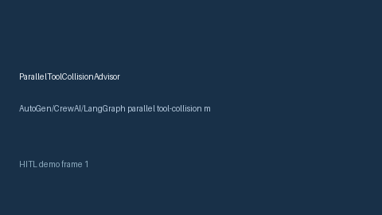

# ParallelToolCollisionAdvisor Guide



Offline HITL advisor for `collision_ratio` bands. Gap vs AutoGen/CrewAI/LangGraph parallel tool-collision monitors. Distinct from `ToolCallWaveAdvisor` / `ToolResultDeduper`.

Optional polish via **GPT-5.5 / Claude Sonnet 4.6 / Gemini 3.x / Kimi K2**.

## Usage

```python
from multi_bot_agentic.parallel_tool_collision import ParallelToolCollisionAdvisor

status = ParallelToolCollisionAdvisor().advise("s1", collision_ratio=0.3)
assert status.requires_human_review is True
print(status.band)
```

## Safety

Advisory only. No network I/O. Humans decide.
