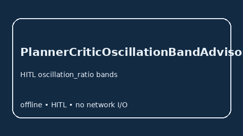

# PlannerCriticOscillationBandAdvisor Guide



Offline HITL `oscillation_ratio` bands. Gap vs LangGraph/CrewAI/AutoGen planner-critic oscillation monitors. Distinct from `PlannerReplanThrashAdvisor` / `CriticCollusionBandAdvisor`.

Optional polish via **GPT-5.5 / Claude Sonnet 4.6 / Gemini 3.x / Kimi K2**.

## Usage

```python
from multi_bot_agentic.planner_critic_oscillation_band import PlannerCriticOscillationBandAdvisor

status = PlannerCriticOscillationBandAdvisor().advise("s1", oscillation_ratio=0.3)
assert status.requires_human_review is True
print(status.band)
```

## Safety

Advisory only. No network I/O. Humans decide.
