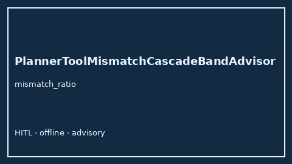

# PlannerToolMismatchCascadeBandAdvisor Guide



Offline HITL `mismatch_ratio` band advisor.
Gap vs LangGraph/CrewAI/AutoGen planner-tool mismatch cascade monitors. Distinct from `PlannerToolMismatchBandAdvisor` / `PlanGoalContradictionBandAdvisor`.

Stack: **GPT-5.5 / Claude Sonnet 4.6 / Gemini 3.x / Kimi K2**.

## Usage

```python
from multi_bot_agentic.planner_tool_mismatch_cascade_band import PlannerToolMismatchCascadeBandAdvisor

status = PlannerToolMismatchCascadeBandAdvisor().advise("session-1", mismatch_ratio=0.85)
assert status.requires_human_review is True
print(status.band)
```

## Safety

Advisory only. No network I/O. Humans decide.
