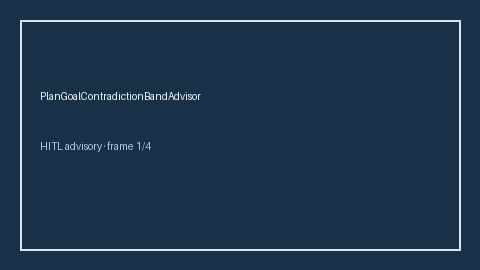

# PlanGoalContradictionBandAdvisor Guide



Offline HITL advisor. Never network I/O. Closes gaps vs AutoGen/CrewAI/LangGraph plan-goal contradiction band advisors.

Optional polish via **GPT-5.5 / Claude Sonnet 4.6 / Gemini 3.x / Kimi K2**.

Distinct from `PlannerGoalDriftGuard` / `PlanStepCycleDetectorGuard`.

## Usage

```python
from multi_bot_agentic.plan_goal_contradiction_band import PlanGoalContradictionBandAdvisor

status = PlanGoalContradictionBandAdvisor().advise("s1", contradiction_score=0.1)
assert status.requires_human_review is True
print(status.band)
```

## Safety

Always `requires_human_review=True`. No HTTP. Humans decide.
