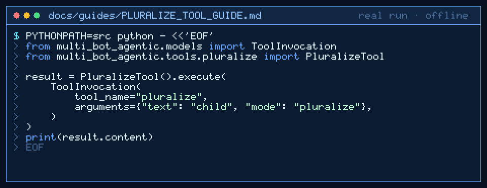

# pluralize Tool Guide



Pluralize or singularize an English word before the next GPT-6 Astra / Claude Opus 5.5 / Gemini 4 Argon / Kimi K3.1 Pro turn.

## Why

Agent pipelines need deterministic English plurals for labels and counts. Models invent irregular forms. Inspired by text utilities in LangChain/crewAI toolkits that rarely ship a focused pluralize tool.

## Usage

```python
from multi_bot_agentic.models import ToolInvocation
from multi_bot_agentic.tools.pluralize import PluralizeTool

result = PluralizeTool().execute(
    ToolInvocation(
        tool_name="pluralize",
        arguments={"text": "child", "mode": "pluralize"},
    )
)
print(result.content)
```

## Bounds & Safety

- Max text 2000 chars; single word only
- Modes: `pluralize` (default) or `singularize`
- Common irregulars included
- Never executes code or makes network requests
