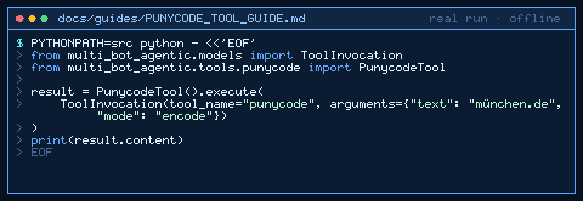

# punycode Tool Guide



Internationalized domain names need xn-- Punycode before the next GPT-6 Astra / Claude Opus 5.5 / Gemini 4 Argon / Kimi K3.1 Pro turn.

## Why

Internationalized domain names need xn-- Punycode. Models invent encodings. Gap fill vs agent toolkits that ship URL parsers but skip IDNA. Uses stdlib encodings.idna only.

## Usage

```python
from multi_bot_agentic.models import ToolInvocation
from multi_bot_agentic.tools.punycode import PunycodeTool

result = PunycodeTool().execute(
    ToolInvocation(tool_name="punycode", arguments={"text": "münchen.de", "mode": "encode"})
)
print(result.content)
```

## Bounds & Safety

- Max text 2000 chars
- Modes: `encode` (default) or `decode`
- Stdlib IDNA codec only
- Never executes code or makes network requests
