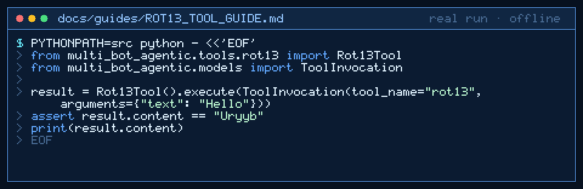

# ROT13 Tool Guide



Deterministic ROT13 for GPT-6 Astra / Claude Opus 5.5 / Gemini 4 Argon / Kimi K3.1 Pro workers.

## Why

Models invent Caesar shifts. This tool applies stdlib `codecs` ROT13 with no network.

## Usage

```python
from multi_bot_agentic.tools.rot13 import Rot13Tool
from multi_bot_agentic.models import ToolInvocation

result = Rot13Tool().execute(ToolInvocation(tool_name="rot13", arguments={"text": "Hello"}))
assert result.content == "Uryyb"
print(result.content)
```

## Bounds

- Max 20_000 characters
- Letters only are rotated; digits/punctuation preserved
- Encode and decode are identical (self-inverse)

## Safety

Allowlisted; no code execution; no network.
