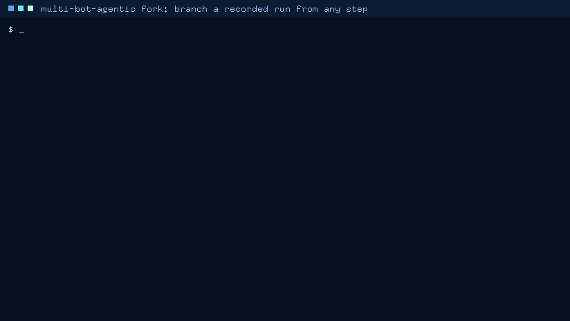
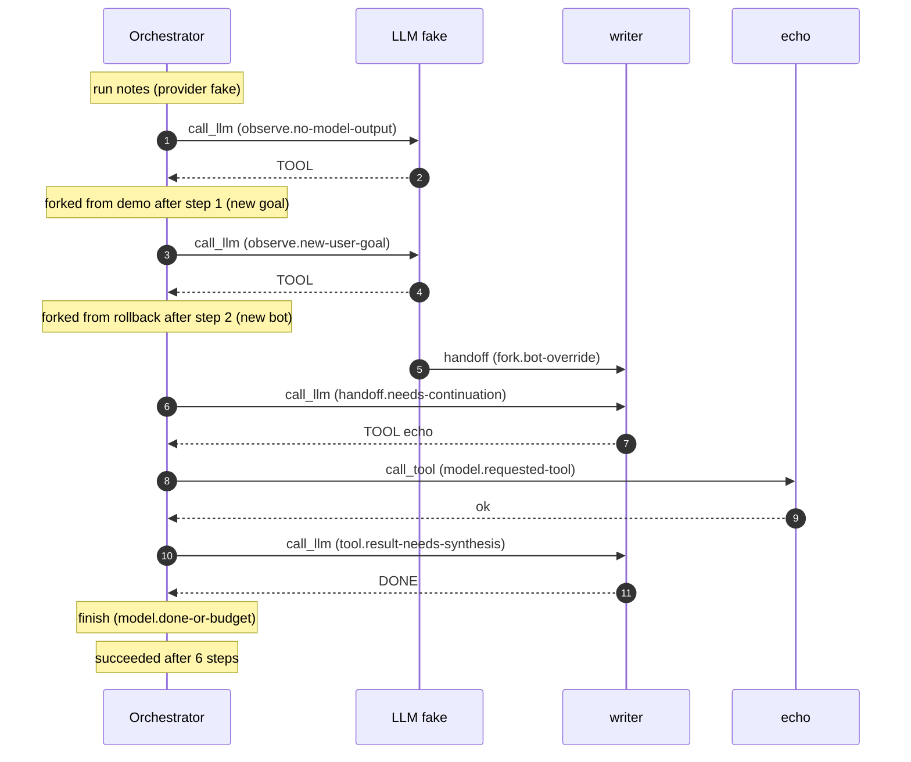

# Run Fork Guide: Time-Travel Forks



`multi-bot-agentic fork` branches a recorded run after any step and continues it as a new run, with a
different goal, provider, bot, or step budget. `multi-bot-agentic history` lists the steps a run took and which
ones you can branch from.

A fork never touches its source run. It rebuilds the runtime state after step N from the event log alone,
without calling a provider. It then writes a new run that starts with a `run_forked` lineage event, copies the
source's events up to that point, and runs the remaining steps. Because the copies are part of the new run,
`replay`, `report`, and `trace` of a fork are self-contained and never call a provider.

Use it when you want to:

- **Debug a bad step.** The agent went wrong at step 3, so fork after step 2 and try another provider or bot
  without re-running, and paying for, steps 1 and 2.
- **Iterate on the goal.** Keep the steps that gathered context and change only what happens next.
- **Compare providers from the same state.** Fork the same step twice, once with `--provider openai` and once
  with `--provider gemini`.
- **Recover a failed or interrupted run.** A run that failed at step 4 (provider outage) or died mid-step can be
  forked after step 3. Unlike `resume`, this works for finished runs too, and it keeps the original.
- **Check a narrower scope.** Fork as a bot with fewer tools to see what the run would have done under it.

## Why

Other agent and workflow frameworks can re-execute from a point in a run's history:

| Project | Branch from an earlier point | How you pick the point | What happens to the original |
| --- | --- | --- | --- |
| [LangGraph time travel](https://docs.langchain.com/oss/python/langgraph/use-time-travel) | Replay or fork from any checkpoint. `update_state` writes modified state as a new checkpoint, then `invoke(None, config)` continues | A checkpoint id from `get_state_history` | Kept. The fork is a new checkpoint in the same thread |
| [CrewAI replay](https://docs.crewai.com/en/learn/replay-tasks-from-latest-crew-kickoff) | `crewai replay -t <task_id>` re-runs the crew from a task, including all later tasks | A task id from `crewai log-tasks-outputs`; only the latest kickoff | Earlier task outputs of that kickoff are reused as context |
| [Temporal reset](https://docs.temporal.io/workflow-execution/event#reset) | `temporal workflow reset --event-id` copies the event history up to the reset point into a new execution that continues from there ([CLI](https://docs.temporal.io/cli/command-reference/workflow#reset)) | An event id | Terminated |
| multi-bot-agentic before this feature | `resume` continues only an interrupted run, from its latest checkpoint | None | Not applicable |
| **multi-bot-agentic `fork`** | Any recorded step of any run (finished, failed, or interrupted) into a new run, with an optional new goal, provider, bot, or step budget | A step number from `history` | Kept, unchanged |

The design takes the copied history from Temporal, and the checkpoint lookup and kept original from
LangGraph. It adds what an auditable orchestrator needs:

- **Explicit, verifiable lineage.** The fork records its parent, the fork step, the SHA-256 digest of the event
  it branched from, and a digest of every event it inherited. `report` re-checks the inherited events against
  that digest.
- **Safety re-checks at the fork point.** The tool scope comes from the current bot registry and safety policy,
  never from the log. A bot switch cannot run a tool request that the previous bot was refused.
- **Deterministic and offline.** With the fake provider, the same forks make the same decisions, tool calls, and
  answers (only random observation ids and timestamps differ), so CI can exercise forks without API keys.
- **Observable.** In `trace`, the fork's root span gets an OpenTelemetry span link to the parent run's root
  span, and Mermaid diagrams mark where the inherited steps end.

LangGraph's `update_state` can rewrite any state channel. A fork here changes only the goal, provider, bot,
and step budget, which are the parts of the state the runner owns.

## Quickstart

Everything below runs offline with the deterministic fake provider:

```bash
# 1. Record a run in a fresh log (run ids must be unique per log)
rm -f demo-output/fork.sqlite
multi-bot-agentic run --goal "Create a launch checklist" --provider fake \
  --event-log demo-output/fork.sqlite --run-id demo

# 2. List the steps you can branch from
multi-bot-agentic history --event-log demo-output/fork.sqlite --run-id demo

# 3. Preview a fork after step 1 with a new goal (writes nothing)
multi-bot-agentic fork --event-log demo-output/fork.sqlite --run-id demo --at-step 1 \
  --new-run-id rollback --goal "Create a rollback checklist" --provider fake --dry-run

# 4. Run the fork
multi-bot-agentic fork --event-log demo-output/fork.sqlite --run-id demo --at-step 1 \
  --new-run-id rollback --goal "Create a rollback checklist" --provider fake

# 5. Fork the fork as the writer bot from the bundled registry (the fake model asks for echo)
MULTIBOT_FAKE_TOOL=echo multi-bot-agentic fork --event-log demo-output/fork.sqlite --run-id rollback \
  --at-step 2 --new-run-id notes --bots examples/bots/release-crew.json --bot writer --provider fake

# 6. Inspect the lineage
multi-bot-agentic report --event-log demo-output/fork.sqlite --run-id rollback
multi-bot-agentic history --event-log demo-output/fork.sqlite --run-id notes
multi-bot-agentic trace --event-log demo-output/fork.sqlite --run-id notes --format mermaid
```

This is the real output of step 2. Each row is one Observe → Decide → Act step. The `fork` column says
whether the state after the step was recorded:

```text
run demo: succeeded after 4 steps (provider fake)
goal: Create a launch checklist
step  bot  action     target     rule                         outcome         fork
   0  -    start      -          -                            -               yes
   1  -    call_llm   fake       observe.no-model-output      TOOL checklist  yes
   2  -    call_tool  checklist  model.requested-tool         checklist ok    yes
   3  -    call_llm   fake       tool.result-needs-synthesis  DONE            yes
   4  -    finish     -          model.done-or-budget         succeeded       no
forkable steps: 0, 1, 2, 3
```

After step 1 the model has asked for `checklist` with the old goal. Step 4 prints the fork's note on stderr
and its result on stdout:

```text
note: forked run demo after step 1 into rollback (9 events inherited; new goal)
{
  "run_id": "rollback",
  "parent_run_id": "demo",
  "fork_step": 1,
  "state": "succeeded",
  "answer": "synthesized plan from 5 observations",
  "steps": 5,
  "event_log": "demo-output/fork.sqlite"
}
```

The history of the fork of the fork (step 6). Steps marked `*` were inherited, and the writer bot took over
at step 3. Steps 1 and 2 show `TOOL` without `checklist` because this run never called `checklist`, and a
directive's target is model output:

```text
run notes: succeeded after 6 steps (provider fake)
forked from rollback after step 2 (new bot); * = inherited
goal: Create a rollback checklist
step  bot     action     target  rule                         outcome    fork
  0*  -       start      -       -                            -          yes
  1*  -       call_llm   fake    observe.no-model-output      TOOL       yes
  2*  -       call_llm   fake    observe.new-user-goal        TOOL       yes
   3  writer  call_llm   fake    handoff.needs-continuation   TOOL echo  yes
   4  writer  call_tool  echo    model.requested-tool         echo ok    yes
   5  writer  call_llm   fake    tool.result-needs-synthesis  DONE       yes
   6  writer  finish     -       model.done-or-budget         succeeded  no
forkable steps: 0, 1, 2, 3, 4, 5
```

## Steps And Fork Points

Steps count completed Observe → Decide → Act iterations, starting at 1. **"After step N"** is the latest
checkpoint recorded for step N. The runner writes one at the end of every step that did not end the run,
with the goal, the observations the next step will see, and the active bot. Step 0 is the start: the goal and
nothing else (for a run that was itself forked at step 0, its starting checkpoint).

| Step in `history` | `fork --at-step` | Why |
| --- | --- | --- |
| 0 | Accepted | Starts over from the goal, keeping the lineage |
| A step followed by a checkpoint | Accepted | Its state was recorded |
| The step that ended the run (`finish`, `fail`, `cancel`) | Refused | No later state exists. Fork the step before it, perhaps with `--goal` |
| The step an interrupted run died in | Refused | Its action never recorded a result. Fork the step before it, or `resume` the run |
| Beyond the last step | Refused | Nothing was recorded there |

The fork's first own step decides on the rebuilt state, plus any overrides:

| Option | What the first new step does |
| --- | --- |
| None | Exactly what the source did next. A fork without options continues like `resume` would have if the run had died right after step N |
| `--goal` | Appends the goal as a new `user` observation. The `observe.new-user-goal` rule makes the model answer it first, so a directive the model gave for the old goal (`TOOL:checklist:<old goal>`) is not executed. With `--at-step 0`, the new goal replaces the old one |
| `--bot` | Records a handoff to the bot (drawn as `fork.bot-override` in traces). The `handoff.needs-continuation` rule makes the model continue under the bot's scope before any tool runs |
| `--provider` | The next model call uses the new provider. A tool request already in the state still runs, because it is part of the state. Fork an earlier step to let the new provider choose the tools |
| `--max-steps` | Sets the fork's whole budget. Inherited steps count, so `max_steps - N` steps remain |

A fork checkpoints its own starting state (with its overrides) before its first step. This has two effects:

- **A fork that dies in its first step resumes with its overrides.** `resume` restores the latest checkpoint,
  which is the fork's start, not the inherited state.
- **Forking a fork at its fork step gives the fork's starting state.** Earlier steps give the parent's states,
  because those checkpoints were inherited.

## CLI Reference

`python -m multi_bot_agentic.cli history|fork ...` works the same way.

### `history`

```text
usage: multi-bot-agentic history [-h] --event-log EVENT_LOG [--run-id RUN_ID] [--format {text,json}]
```

| Option | Default | Meaning |
| --- | --- | --- |
| `--event-log` | required | SQLite event log to read. It is never created if missing |
| `--run-id` | most recently active run | Run to list (a note on stderr names the run that was picked) |
| `--format` | `text` | `text` prints the table above. `json` prints the same rows with `forkable_steps`, `last_step`, `final_state`, and the run's `lineage` |

Columns: `step` (`*` = inherited from the parent run), `bot` (active while the step decided), `action`,
`target`, `rule` (the rationale rule id), `outcome` (the model's directive such as `TOOL checklist` or `DONE`, a
tool result such as `checklist ok`, `handoff to <bot>`, or the run's end such as `succeeded`, `failed`, or
`interrupted`), and `fork` (whether `--at-step` accepts the step). A directive's target is model output, so, as
in Mermaid exports, it is shown only when it names a tool the run called or a bot it ran; otherwise the
outcome is just `TOOL` or `HANDOFF`.

### `fork`

```text
usage: multi-bot-agentic fork [-h] --event-log EVENT_LOG --run-id RUN_ID --at-step AT_STEP --new-run-id NEW_RUN_ID
                              [--goal GOAL] [--provider PROVIDER] [--bot BOT] [--bots BOTS] [--max-steps MAX_STEPS]
                              [--mcp-config MCP_CONFIG] [--dry-run]
```

| Option | Default | Meaning |
| --- | --- | --- |
| `--event-log` | required | SQLite event log holding the source run. The fork is added to the same log. A missing log is an error, never created |
| `--run-id` | required | Run to branch from. It is read only |
| `--at-step` | required | Branch after this step (an integer from 0 up); see [Steps And Fork Points](#steps-and-fork-points) |
| `--new-run-id` | required | Run id of the fork. Refused if any run in the log already uses it |
| `--goal` | source goal | New goal for the remaining steps. It passes the same checks as `run --goal` (non-empty, at most `MULTIBOT_MAX_PROMPT_CHARS`) |
| `--provider` | `MULTIBOT_PROVIDER`, else `fake` | `fake`, `openai`, `claude_code`, `gemini`, or `kimi`, as for `run`. It does **not** default to the source's provider, so a fork never spends tokens unless you ask. The adapter is built before anything is written, so missing credentials fail cleanly |
| `--bot` | bot at the fork point | Registered bot to continue as. Requires `--bots` |
| `--bots` | none | Bot registry JSON (see below). Also required to fork a run that was running as a bot at the fork point |
| `--max-steps` | `MULTIBOT_MAX_STEPS`, else 6 | The fork's step budget, inherited steps included. It must be greater than `--at-step` |
| `--mcp-config` | none | MCP servers whose tools the fork may use, as for `run` and `resume`. With `--dry-run` the servers are started to list their tools, but no tool is called |
| `--dry-run` | off | Validate, then print the rebuilt state, the overrides, and the first decision as JSON. Nothing is written and the provider is never called |

Exit codes: `0` when the fork succeeded or the dry run passed, and `2` otherwise. A refused fork prints one
`error:` line on stderr and writes nothing. A fork that ran but did not succeed (failed or cancelled) also
exits 2, like `run`.

On success, stderr gets one `note:` line and stdout gets the result as JSON (see the [Quickstart](#quickstart)).

#### Dry run

Real output of step 3 of the quickstart:

```json
{
  "dry_run": true,
  "source_run_id": "demo",
  "new_run_id": "rollback",
  "fork_step": 1,
  "goal": "Create a rollback checklist",
  "provider": "fake",
  "bot": null,
  "bot_tools": null,
  "max_steps": 6,
  "remaining_steps": 5,
  "overrides": {
    "goal": "Create a rollback checklist"
  },
  "parent_event": {
    "seq": 9,
    "event_type": "checkpoint",
    "sha256": "ef73272d4175dd40d529dafc8e168a5d94c7df105b31da1d20e87281fc412667"
  },
  "inherited_events": 9,
  "prefix_sha256": "2ded9249f1c9c14a2ef28ae9e6ee910eb3dfcb2fe28a9802710bdbeb56e31686",
  "observations": [
    {
      "source": "user",
      "content": "Create a launch checklist"
    },
    {
      "source": "llm:fake",
      "content": "TOOL:checklist:Create a launch checklist"
    },
    {
      "source": "user",
      "content": "Create a rollback checklist"
    }
  ],
  "next_decision": {
    "action": "call_llm",
    "target": "fake",
    "rule_id": "observe.new-user-goal"
  }
}
```

`observations` are what the first new step decides on, `next_decision` is what it will decide (the engine is
deterministic), and `bot_tools` is the bot's tool scope when a bot is active. Your digests will differ: they
cover observation ids, which are random UUIDs.

#### Bot registry (`--bots`)

The CLI has no built-in bots. A registry file defines each bot's tool scope:

```json
{
  "bots": {
    "planner": {
      "name": "Planner",
      "description": "Plans the release with checklists",
      "allowed_tools": ["checklist"]
    },
    "writer": {
      "name": "Writer",
      "description": "Writes release notes",
      "allowed_tools": ["echo"]
    }
  }
}
```

That is [`examples/bots/release-crew.json`](../../examples/bots/release-crew.json). `allowed_tools` is
required and must be a non-empty list of tool names. `name` defaults to the bot id, and `description` is
optional. Unknown keys are rejected, so a typo such as `"tools"` cannot silently drop a scope. Every bot's tools
must be in the safety policy's allowlist: the built-in tools, plus the MCP tools of `--mcp-config`.

Here is how the registry, the log, and `--bot` combine:

- The run was running as a bot at the fork point, and you pass no `--bot`. The fork continues as that bot, with
  the bot's scope from the registry. If the registry doesn't define the bot, the fork is refused.
- You pass `--bot`. The fork switches to that bot through a handoff.
- The run had no bot, and you pass no `--bot`. The fork uses the full policy allowlist, like `run`.

#### Environment variables

`fork` reads the same settings as `run`: `MULTIBOT_PROVIDER`, `MULTIBOT_MAX_STEPS`, `MULTIBOT_TIMEOUT_SECONDS`,
`MULTIBOT_MAX_PROMPT_CHARS`, `MULTIBOT_CANCEL_FILE`, `MULTIBOT_FAKE_TOOL`, and the provider credentials and model
variables ([Configuration](../CONFIGURATION.md)). `history` reads none. There are no new variables.

## Library API

```python
from pathlib import Path

from multi_bot_agentic.bots import BotSpec
from multi_bot_agentic.event_log import SQLiteEventLog
from multi_bot_agentic.fork import build_history, plan_fork
from multi_bot_agentic.llm.fake import FakeLLMAdapter
from multi_bot_agentic.runner import AgentRunner, build_default_tools
from multi_bot_agentic.safety import SafetyPolicy

path = Path("demo-output/fork-api.sqlite")
path.unlink(missing_ok=True)
log = SQLiteEventLog(path)
bots = {"writer": BotSpec(bot_id="writer", name="Writer", allowed_tools=frozenset({"echo"}))}
policy = SafetyPolicy(max_steps=6)


def runner(tool: str = "checklist") -> AgentRunner:
    """A runner with the deterministic fake model, which asks for ``tool`` on its first turn."""
    return AgentRunner(
        provider=FakeLLMAdapter(tool_name=tool),
        event_log=log,
        tools=build_default_tools(root=Path.cwd()),
        safety_policy=policy,
        bots=bots,
    )


runner().run("Create a launch checklist", run_id="api-demo")
print("forkable:", build_history(log.list_events("api-demo")).forkable_steps())

# Validate and preview without writing anything (what `fork --dry-run` prints).
plan = plan_fork(log, "api-demo", 1, "api-notes", provider="fake", policy=policy, bots=bots, bot_id="writer")
print("next:", plan.next_decision.action, plan.next_decision.rationale.rule_id, "| steps left:", plan.remaining_steps)

result = runner(tool="echo").fork("api-demo", 1, "api-notes", bot_id="writer")
print("fork:", result.run_id, result.state.value, result.steps)
for row in build_history(log.list_events("api-notes")).steps:
    print(row.step, "*" if row.inherited else " ", row.bot, row.action, row.rule_id, row.outcome)
log.close()
```

Real output:

```text
forkable: (0, 1, 2, 3)
next: call_llm handoff.needs-continuation | steps left: 5
fork: api-notes succeeded 5
0 * None None None start
1 * None call_llm observe.no-model-output TOOL
2   writer call_llm handoff.needs-continuation TOOL echo
3   writer call_tool model.requested-tool echo ok
4   writer call_llm tool.result-needs-synthesis DONE
5   writer finish model.done-or-budget succeeded
```

| API | Purpose |
| --- | --- |
| `AgentRunner.fork(source_run_id, at_step, new_run_id, *, goal=None, bot_id=None)` | Validate, write the fork, and run it with this runner's provider, tools, bots, and policy. Raises `ForkError` before writing anything |
| `multi_bot_agentic.fork.plan_fork(event_log, source_run_id, at_step, new_run_id, *, provider, policy, bots=None, goal=None, bot_id=None)` | Every check plus the rebuilt state, overrides, lineage payload, and first decision, without writing |
| `build_history(events)` | Steps of one run (`RunHistory.steps`, `forkable_steps()`, `lineage`) |
| `reconstruct_fork_point(events, step)` | The state after a step: goal, observations, bot, the event that recorded it, and the events a fork would inherit |
| `run_lineage(events)`, `fork_children(events)`, `inherited_events_intact(events, lineage)` | Read lineage, find a run's forks, and re-check inherited events |
| `event_digest(event)`, `prefix_digest(events)` | The SHA-256 digests recorded in the lineage |
| `bots.load_bot_registry(path)` | Load a `--bots` file |
| `checkpoint.snapshot_from_event(event)` | Parse one checkpoint event, as `load_latest_checkpoint` does for the latest one |

## What A Fork Writes

A fork adds one new run to the event log:

| Events | Content |
| --- | --- |
| 1 | `run_forked`: the lineage (below) |
| 2 to K+1 | Copies of the source's events up to and including the fork-point event (K = `inherited_events`). Event type, state, and payload are identical, and the copies get new sequence numbers and timestamps |
| Next, only with a bot switch | `action_result` with `kind: handoff`, `fork_override: true`, `from_bot`, `to_bot`, and the new bot's `allowed_tools` |
| Next | `checkpoint` with `step` N: the fork's starting goal, observations (overrides included), and bot |
| The rest | The fork's own steps, exactly as `run` writes them |

The lineage payload, as `replay --event-type run_forked` prints it (real output from the quickstart):

```json
{"event_type": "run_forked", "payload": {"bot": null, "fork_step": 1, "goal": "Create a rollback checklist", "inherited_events": 9, "max_steps": 6, "overrides": {"goal": "Create a rollback checklist"}, "parent_event": {"event_type": "checkpoint", "seq": 9, "sha256": "ef73272d4175dd40d529dafc8e168a5d94c7df105b31da1d20e87281fc412667"}, "parent_run_id": "demo", "prefix_sha256": "2ded9249f1c9c14a2ef28ae9e6ee910eb3dfcb2fe28a9802710bdbeb56e31686", "provider": "fake"}, "run_id": "rollback", "seq": 1, "state": "created", "timestamp": "2026-11-13T05:36:15.529966+00:00"}
```

| Field | Meaning |
| --- | --- |
| `parent_run_id`, `fork_step` | The source run and the step the fork continued after |
| `parent_event` | `seq`, `event_type`, and `sha256` of the source event that recorded the state: the checkpoint after the step, or the first `run_created` event for step 0 |
| `inherited_events`, `prefix_sha256` | How many events were copied, and their digest |
| `goal`, `provider`, `bot`, `max_steps` | What the fork continued with |
| `overrides` | What differs from the source at the fork point: `goal`, `bot`, or `provider` |

`event_digest` is the SHA-256 of the canonical JSON (sorted keys, no spaces) of an event's `event_type`, `state`,
and `payload`. The run id, sequence number, and timestamp are left out, so a copy hashes like its original.
`prefix_digest` is the SHA-256 of the concatenated event digests, in order.

When the source is itself a fork, its own `run_forked` event is copied with the other inherited events. The
whole ancestry stays in the new run's log. The one exception is a fork of a fork at a step before the parent's
fork step: the parent's lineage event would no longer describe a complete copy, so it is left out.

## Lineage In `replay`, `report`, And `trace`

All three only read the log.

`replay --format text` prints the lineage as the first event. The inherited checkpoint (`acting`) is followed
by the fork's starting checkpoint (`created`):

```text
001 created    run_forked parent=demo step=1 inherited=9
002 created    run_created
003 observing  state_transition
...
010 acting     checkpoint
011 created    checkpoint
012 observing  state_transition
```

`report` adds `lineage` to forks and to runs that were forked. Other runs are reported as before.
`inherited_events_verified` recomputes the digest of the fork's inherited events; it turns `false` if any of
them was edited after the fork:

```json
"lineage": {
  "parent": {
    "parent_run_id": "demo",
    "fork_step": 1,
    "parent_event_seq": 9,
    "parent_event_sha256": "ef73272d4175dd40d529dafc8e168a5d94c7df105b31da1d20e87281fc412667",
    "inherited_events": 9,
    "prefix_sha256": "2ded9249f1c9c14a2ef28ae9e6ee910eb3dfcb2fe28a9802710bdbeb56e31686",
    "provider": "fake",
    "bot": null,
    "max_steps": 6,
    "overrides": {
      "goal": "Create a rollback checklist"
    },
    "inherited_events_verified": true
  },
  "children": [
    {
      "run_id": "notes",
      "fork_step": 2,
      "overrides": {
        "bot": "writer"
      }
    }
  ]
}
```

`trace` exports a fork as its own trace (its trace id comes from its own run id) and connects it to the parent:

- **A span link** on the root `invoke_agent` span, pointing at the parent run's root span. That span's ids are
  derived from the parent run id, so the link resolves when the parent was exported too. OpenTelemetry
  [describes links](https://opentelemetry.io/docs/specs/otel/overview/#links-between-spans) as the way to
  relate an originating trace to the trace that follows it. This is real output for `notes`, with each
  attribute condensed to one line:

  ```json
  "links": [
    {
      "traceId": "5aee50f60bc311c60c219598023587af",
      "spanId": "47dcef87827ca4b8",
      "attributes": [
        {"key": "multi_bot_agentic.link.type", "value": {"stringValue": "forked_from"}},
        {"key": "multi_bot_agentic.fork.step", "value": {"intValue": "2"}}
      ]
    }
  ]
  ```

- **Root attributes** for backends that don't display links: `multi_bot_agentic.fork.parent_run_id`, `.step`,
  `.inherited_events`, and `.overrides` (override names only, never the new goal).
- **A `multi_bot_agentic.run.forked` span event** on the root, where the inherited steps end. A fork of a fork
  also gets the ancestor's fork point, with `multi_bot_agentic.fork.ancestor=true`.
- **`multi_bot_agentic.fork.inherited=true`** on `chat` and `execute_tool` spans copied from the parent. Their
  durations are close to zero, because copying is instantaneous. The original timing is in the parent's trace.
- **Resumes are counted correctly.** The fork's own start is not counted as a resume, but a crash and `resume`
  inside the fork still is.

`trace --format mermaid` adds a note where each fork's inherited steps end. This is real output for `notes`:



## How It Works

1. **Scan.** `history` and `fork` walk the source run's events once. Each `decision` opens a step, its
   `action_result` gives the outcome, and the checkpoint after it closes the step as forkable. A terminal event
   closes the step as the run's end, and a step still open at the end of the log was interrupted. Handoffs and
   checkpoints track the active bot.
2. **Rebuild.** For step N, the latest checkpoint with `step` N is parsed with the same code `resume` uses. Its
   goal, observations (with their original ids), and active bot become the state. For step 0 of an original run,
   the state is the goal from `run_created`, with the id of the goal observation the run logged.
3. **Check** (see [Safety](#safety-privacy-and-limits)). If any check fails, nothing has been written.
4. **Apply overrides.** A bot switch appends a handoff observation. A new goal appends a `user` observation, or
   replaces the goal at step 0. The decision engine computes the first decision, which is what `--dry-run`
   shows.
5. **Write.** The runner appends the lineage event, the copies, the handoff event (for a bot switch), and the
   starting checkpoint.
6. **Continue.** The runner's normal Observe → Decide → Act loop runs from loop index N with a fresh state
   machine, the new run id, and the fork's goal, provider, bot scope, and budget. Every step after that is
   identical to a `run` step, including checkpoints, so a fork can be resumed, forked, and traced like any run.

## Safety, Privacy, And Limits

### Safety

Every check fails closed, before anything is written:

- **Recorded steps only.** A step beyond the source's last step, the step that ended it, or a step the run was
  interrupted in is refused. The error lists the forkable steps.
- **No overwrites.** A `--new-run-id` that already exists in the log is refused, and so is the source's own id.
  The source run is only read.
- **Scopes come from configuration, not from the log.** A bot's tool scope is taken from the runner's registry
  (`--bots`), never from the `allowed_tools` a past handoff recorded. A bot that the registry doesn't define is
  refused, whether it was active at the fork point or named with `--bot`.
- **No privilege escalation with `--bot`.** A bot whose scope includes tools outside the safety policy
  allowlist is refused: a fork never widens the allowlist. Switching bots is recorded as a handoff, so the
  first new step is a model call under the new scope. A tool request the previous bot was refused is never
  executed by the new bot, unless the model asks again under the new scope.
- **Re-validated tool requests.** Tool requests in the restored state go through the decision engine's
  allowlist check under the fork's scope, like every other request.
- **Budgets hold.** `max_steps` counts inherited steps and must leave at least one new step. The engine's final
  budget step still finishes the run. Timeouts, prompt limits, and the cancellation file apply as in `run`.
- **Provider calls are explicit.** `--provider` defaults to `MULTIBOT_PROVIDER` or `fake`, not to the source's
  provider. `--dry-run`, `history`, `replay`, `report`, and `trace` never call a provider.

### Privacy

A fork copies the source's events, including goals, model outputs, and tool results, into the new run in the
same log, and the lineage event stores the fork's goal. Treat the log as you would any event log: a fork does
not move data anywhere else. `trace` exports override names, never values, and keeps content opt-in
(`--include-content`, redacted) as for any run.

### Limits

- **Steps after the fork point run again for real.** A real provider may answer differently, and tools with side
  effects run again. Steps before the fork point are copied, not re-executed.
- **Checkpoint granularity.** A fork point is a step boundary. You cannot fork in the middle of a step, for
  example between a model's answer and the tool call it asked for. Fork the step before and let the model ask
  again.
- **Fixed overrides.** Only the goal, provider, bot, and step budget can change. To edit observations, write a
  new run.
- **The source's step budget is not recorded.** The fork's budget is the configured `max_steps`, not the
  source's.
- **Copies are re-timed.** Inherited events get the time they were copied. Their original timing stays in the
  source run, and the trace link points to it.
- **No locking.** As with `resume`, don't run two forks with the same new run id at the same time. If a fork is
  interrupted while copying, rerun it with a new id.
- **MCP tools in dry runs.** With `--mcp-config`, `--dry-run` starts the servers to list their tools, so a bot
  scope that uses MCP tools can be checked. No tool is called.

## Troubleshooting

Every message below is real output:

| Message | Fix |
| --- | --- |
| `error: step 4 ended run demo (finish -> succeeded); forkable steps: 0, 1, 2, 3` | The terminal step has no later state. Fork an earlier step, usually with `--goal` |
| `error: step 7 is beyond the last step of run demo (step 4); forkable steps: 0, 1, 2, 3` | Pick a step from `history` |
| `error: step 3 of run crashed never recorded a result (the run was interrupted during it); forkable steps: 0, 1, 2` | Fork the step before, or `resume` the interrupted run |
| `error: run rollback already exists in event log demo-output/fork.sqlite; choose a new --new-run-id` | Run ids are unique per log. Pick another one |
| `error: run nope not found in event log demo-output/fork.sqlite` | Check the run id with `report` or `history`, and the `--event-log` path |
| `error: event log not found: demo-output/missing.sqlite` | `fork` and `history` never create a log. Check the path |
| `error: --bot needs --bots PATH, the registry that defines the bot's tool scope` | Pass the registry file that defines the bot |
| `error: bot admin is not registered (registered bots: planner, writer)` | Use a bot from the registry, or add it there |
| `error: bot ops allows tools outside the safety policy allowlist (shell); a fork never widens the allowlist` | Narrow the bot's `allowed_tools`, or add the tool to the run (for example, an MCP tool with `--mcp-config`) |
| `error: step 1 of run crew ran as bot planner, which is not registered; register it (CLI: --bots PATH) to fork this run` | The run was multi-bot. Pass a registry that defines that bot |
| `error: bot registry bots.json: bot 'writer' has unknown keys: tools` | The key is `allowed_tools` |
| `error: max_steps=3 leaves no step after step 3; use --max-steps 4 or more (the budget counts inherited steps)` | Raise `--max-steps` (or `MULTIBOT_MAX_STEPS`) |
| `error: missing required environment variable: OPENAI_API_KEY` | Export the provider's key, or fork with `--provider fake` |
| The fork ran but its answer is a stale directive such as `TOOL:checklist:...` | The bot's scope doesn't include the tool the model keeps asking for, so the engine refused it until the budget ran out. Check `history` for `model.disallowed-tool-request` |

## How This Demo Was Recorded

The GIF at the top was rendered from a **real** terminal transcript, committed as
[`assets/demo/run-fork.txt`](../../assets/demo/run-fork.txt). It was recorded on 2026-11-12 on macOS with
Python 3.12, from the repository root, with no `MULTIBOT_*` variables set and `demo-output/fork.sqlite` deleted
first. Each command ran for real, and its stdout and stderr were appended verbatim after a `$ <command>` line:

```bash
multi-bot-agentic run --goal "Create a launch checklist" --provider fake --event-log demo-output/fork.sqlite --run-id demo | jq -c .
multi-bot-agentic history --event-log demo-output/fork.sqlite --run-id demo
multi-bot-agentic fork --event-log demo-output/fork.sqlite --run-id demo --at-step 1 --new-run-id rollback --goal "Create a rollback checklist" --dry-run | jq -c "{remaining_steps, overrides, next_decision}"
multi-bot-agentic fork --event-log demo-output/fork.sqlite --run-id demo --at-step 1 --new-run-id rollback --goal "Create a rollback checklist" --provider fake | jq -c "{run_id, state, answer, steps}"
multi-bot-agentic history --event-log demo-output/fork.sqlite --run-id rollback
MULTIBOT_FAKE_TOOL=echo multi-bot-agentic fork --event-log demo-output/fork.sqlite --run-id rollback --at-step 2 --new-run-id notes --bots examples/bots/release-crew.json --bot writer --provider fake | jq -c "{run_id, state, steps}"
multi-bot-agentic fork --event-log demo-output/fork.sqlite --run-id demo --at-step 1 --new-run-id notes
multi-bot-agentic fork --event-log demo-output/fork.sqlite --run-id demo --at-step 4 --new-run-id again
multi-bot-agentic report --event-log demo-output/fork.sqlite --run-id rollback | jq -c ".runs[0].lineage | {parent: .parent.parent_run_id, verified: .parent.inherited_events_verified, children: [.children[].run_id]}"
multi-bot-agentic trace --event-log demo-output/fork.sqlite --run-id notes --format mermaid
multi-bot-agentic trace --event-log demo-output/fork.sqlite --run-id rollback | jq -c ".resourceSpans[0].scopeSpans[0].spans[0].links[0] | {traceId, spanId}"
```

The transcript was rendered with [`scripts/render_terminal_gif.py`](../../scripts/render_terminal_gif.py), the
renderer of the [trace export demo](OTEL_TRACE_EXPORT_GUIDE.md#how-this-demo-was-recorded). It draws stdlib-only
pixel frames that `ffmpeg` stitches together, using the repository's palette and the public-domain X11 8x13
font. Lines starting with `$ ` are typed; all other lines are printed as captured, and `note:` and `error:` lines
are drawn in the muted color:

```bash
python scripts/render_terminal_gif.py assets/demo/run-fork.txt assets/demo/run-fork.gif \
  --rows 32 --title "multi-bot-agentic fork: branch a recorded run from any step"
```

The other outputs in this guide come from a second, fresh run of the [Quickstart](#quickstart), so its digests
differ from the GIF's.

## Related

- [Checkpoint Resume Guide](CHECKPOINT_RESUME_GUIDE.md): `resume` continues an interrupted run in place; `fork`
  branches any recorded step into a new run.
- [Bot Handoff Guide](BOT_HANDOFF_GUIDE.md): bot scopes and the handoff a `--bot` switch records.
- [OpenTelemetry Trace Export Guide](OTEL_TRACE_EXPORT_GUIDE.md): the span model that fork links extend.
- [Run Replay Diff Guide](RUN_REPLAY_DIFF_GUIDE.md): `RunReplayDiff` compares two event sequences, for example a
  fork's own events with its parent's events after the fork point.
- [MCP Tool Bridge Guide](MCP_TOOLS_GUIDE.md): MCP tools in a fork's scope with `--mcp-config`.
