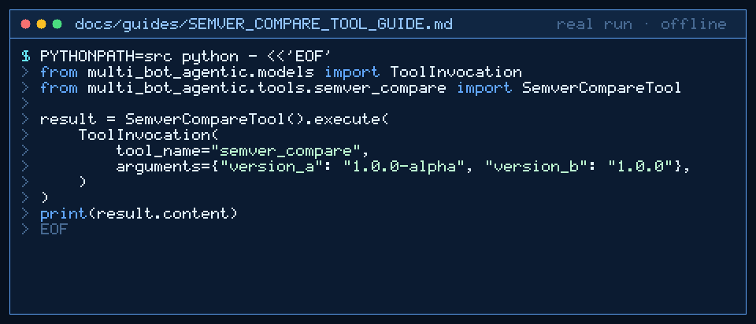

# semver_compare Tool Guide



Compare two semantic versions before the next GPT-6 Astra / Claude Opus 5.5 /
Gemini 4 Argon / Kimi K3.1 Pro turn.

## Why

Version gating is ubiquitous in DevOps agent toolkits, but this repo had no
SemVer helper. Models routinely mis-order pre-releases such as `1.0.0-alpha`
vs `1.0.0`. `semver_compare` applies SemVer 2.0.0 precedence deterministically.

## Usage

```python
from multi_bot_agentic.models import ToolInvocation
from multi_bot_agentic.tools.semver_compare import SemverCompareTool

result = SemverCompareTool().execute(
    ToolInvocation(
        tool_name="semver_compare",
        arguments={"version_a": "1.0.0-alpha", "version_b": "1.0.0"},
    )
)
print(result.content)
```

Sentinel form: `1.2.3<<<SEMVER_COMPARE>>>1.2.4`

Content is `-1`, `0`, or `1` on the first line, then a human relation such as
`1.0.0-alpha < 1.0.0`.

## Bounds & Safety

- Each version max 128 chars
- Core `major.minor.patch` required; optional pre-release and build metadata
- Build metadata is ignored for comparison
- Never executes code or makes network requests
