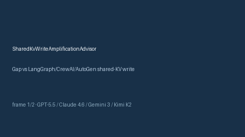

# SharedKvWriteAmplificationAdvisor Guide



Offline HITL advisor for `write_amp_ratio` bands.
Gap vs LangGraph/CrewAI/AutoGen shared-KV write-amplification monitors. Distinct from `BlackboardLeaseThrashAdvisor` / `BlackboardStaleEntryAdvisor`.

Optional polish via **GPT-5.5 / Claude Sonnet 4.6 / Gemini 3.x / Kimi K2**.

## Usage

```python
from multi_bot_agentic.shared_kv_write_amplification import SharedKvWriteAmplificationAdvisor

status = SharedKvWriteAmplificationAdvisor().advise("session-1", write_amp_ratio=0.4)
assert status.requires_human_review is True
print(status.band)
```

## Safety

Advisory only. No network I/O. Never auto-acts. Humans decide.
