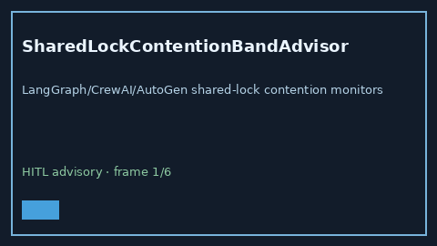

# SharedLockContentionBandAdvisor Guide



Offline HITL `contention_ratio` bands.
Gap vs LangGraph/CrewAI/AutoGen shared-lock contention monitors. Distinct from `FanInBarrierStallAdvisor` / `SupervisorIdleSkewAdvisor`.

Stack: **GPT-5.5 / Claude Sonnet 4.6 / Gemini 3.x / Kimi K2**.

## Usage

```python
from multi_bot_agentic.shared_lock_contention_band import SharedLockContentionBandAdvisor

status = SharedLockContentionBandAdvisor().advise("session-1", contention_ratio=0.4)
assert status.requires_human_review is True
print(status.band)
```

## Safety

Advisory only. No network I/O. Never auto-acts. Humans decide.
