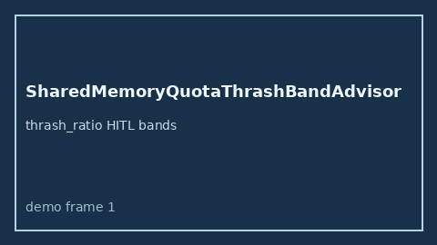

# SharedMemoryQuotaThrashBandAdvisor Guide



Offline HITL `thrash_ratio` bands.
Gap vs LangGraph/CrewAI/AutoGen shared-memory quota thrash monitors. Distinct from `SharedKvWriteAmplificationAdvisor` / `BlackboardReadStalenessAdvisor`.

Stack: **GPT-5.5 / Claude Sonnet 4.6 / Gemini 3.x / Kimi K2**.

## Usage

```python
from multi_bot_agentic.shared_memory_quota_thrash_band import SharedMemoryQuotaThrashBandAdvisor

status = SharedMemoryQuotaThrashBandAdvisor().advise("s1", thrash_ratio=0.8)
assert status.requires_human_review is True
print(status.band)
```

## Safety

Advisory only. No network I/O. Never auto-acts.
