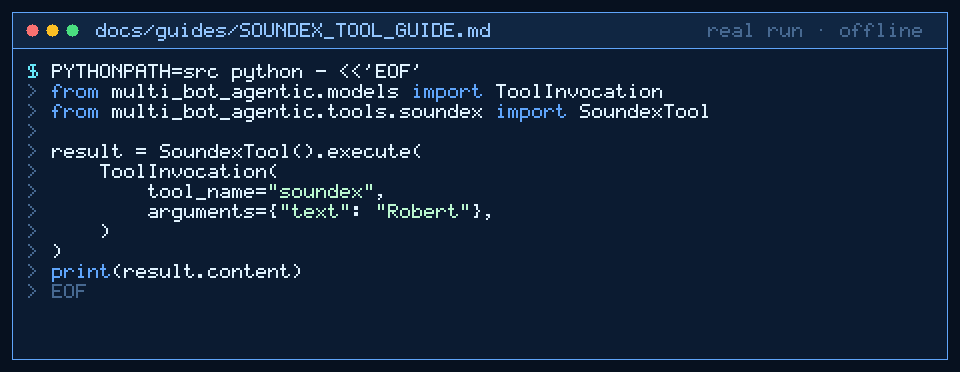

# soundex Tool Guide



Compute deterministic American Soundex phonetic codes for fuzzy name matching
before the next GPT-6 Astra / Claude Opus 5.5 / Gemini 4 Argon / Kimi K3.1 Pro turn.

## Why

CrewAI / LangChain-style agents need a stable phonetic fingerprint when
reconciling person names or vendor labels. Models invent codes; `soundex` uses
classic American Soundex with no network access (inspired by fuzzy name-matching
agent toolkits, implemented with stdlib only).

## Usage

```python
from multi_bot_agentic.models import ToolInvocation
from multi_bot_agentic.tools.soundex import SoundexTool

result = SoundexTool().execute(
    ToolInvocation(
        tool_name="soundex",
        arguments={"text": "Robert"},
    )
)
print(result.content)
```

## Bounds & Safety

- Required: `text` (max 2000 chars)
- Content is the 4-character Soundex code; metadata includes `soundex`
- Never executes code or makes network requests
