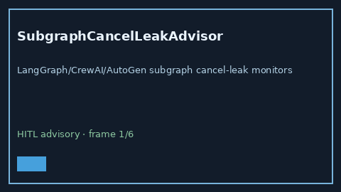

# SubgraphCancelLeakAdvisor Guide



Offline HITL `leak_ratio` bands.
Gap vs LangGraph/CrewAI/AutoGen subgraph cancel-leak monitors. Distinct from `MemoryNamespaceLeakAdvisor` / `AgentLoopTokenBleedAdvisor`.

Stack: **GPT-5.5 / Claude Sonnet 4.6 / Gemini 3.x / Kimi K2**.

## Usage

```python
from multi_bot_agentic.subgraph_cancel_leak import SubgraphCancelLeakAdvisor

status = SubgraphCancelLeakAdvisor().advise("session-1", leak_ratio=0.4)
assert status.requires_human_review is True
print(status.band)
```

## Safety

Advisory only. No network I/O. Never auto-acts. Humans decide.
