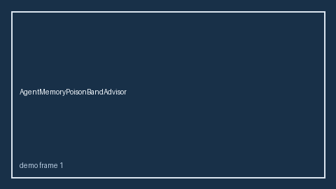

# SubgraphDeadlockResidualBandAdvisor Guide



Offline HITL `deadlock_ratio` bands.
Gap vs LangGraph/CrewAI/AutoGen subgraph deadlock-residual monitors. Distinct from `SubgraphCancelLeakAdvisor` / `AgentHandoffLoopBandAdvisor`.

Stack: **GPT-5.5 / Claude Sonnet 4.6 / Gemini 3.x / Kimi K2**.

## Usage

```python
from multi_bot_agentic.subgraph_deadlock_residual_band import SubgraphDeadlockResidualBandAdvisor

status = SubgraphDeadlockResidualBandAdvisor().advise("session-1", deadlock_ratio=0.3)
assert status.requires_human_review is True
print(status.band)
```

## Safety

Advisory only. No network I/O. Never auto-acts.
