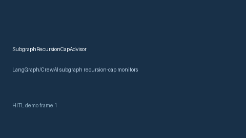

# SubgraphRecursionCapAdvisor Guide



Offline HITL advisor for `recursion_depth_ratio` bands. Gap vs LangGraph/CrewAI subgraph recursion-cap monitors. Distinct from `PlannerStepBudgetBandAdvisor` / `ToolCallQuotaGuard`.

Optional polish via **GPT-5.5 / Claude Sonnet 4.6 / Gemini 3.x / Kimi K2**.

## Usage

```python
from multi_bot_agentic.subgraph_recursion_cap import SubgraphRecursionCapAdvisor

status = SubgraphRecursionCapAdvisor().advise("s1", recursion_depth_ratio=0.3)
assert status.requires_human_review is True
print(status.band)
```

## Safety

Advisory only. No network I/O. Humans decide.
