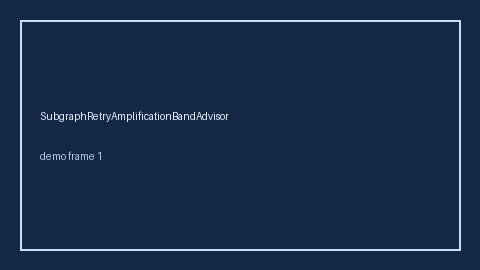

# SupervisorHandoffLoopBandAdvisor Guide



Offline helper.
Gap vs LangGraph/CrewAI/AutoGen supervisor handoff-loop monitors. Distinct from `AgentHandoffLoopBandAdvisor` / `HandoffSchemaDriftBandAdvisor`.

Stack: **GPT-6 Astra / Claude Opus 5.5 / Gemini 4 Argon / Kimi K3.1 Pro**.

## Usage

```python
from multi_bot_agentic.supervisor_handoff_loop_band import SupervisorHandoffLoopBandAdvisor

status = SupervisorHandoffLoopBandAdvisor().advise("session-1", loop_ratio=0.35)
assert status.requires_human_review is True
print(status.band)
```

## Safety

Advisory only. No network I/O. Never auto-acts. Humans decide.
