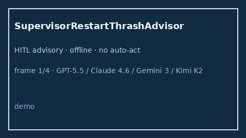

# SupervisorRestartThrashAdvisor Guide



Offline HITL `restart_ratio` bands.
Gap vs LangGraph/CrewAI/AutoGen supervisor restart-thrash monitors. Distinct from `SupervisorIdleSkewAdvisor` / `OrchestratorRetryStormBandAdvisor`.

Stack: **GPT-5.5 / Claude Sonnet 4.6 / Gemini 3.x / Kimi K2**.

## Usage

```python
from multi_bot_agentic.supervisor_restart_thrash import SupervisorRestartThrashAdvisor

status = SupervisorRestartThrashAdvisor().advise("session-1", restart_ratio=0.4)
assert status.requires_human_review is True
print(status.band)
```

## Safety

Advisory only. No network I/O. Never auto-acts.
