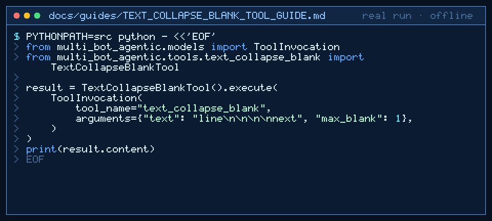

# text_collapse_blank Tool Guide



Collapse consecutive blank or whitespace-only lines before the next GPT-6 Astra /
Claude Opus 5.5 / Gemini 4 Argon / Kimi K3.1 Pro turn.

## Why

Long agent traces accumulate empty lines. Asking a model to tidy whitespace is
unreliable; this tool is deterministic and bounded.

## Usage

```python
from multi_bot_agentic.models import ToolInvocation
from multi_bot_agentic.tools.text_collapse_blank import TextCollapseBlankTool

result = TextCollapseBlankTool().execute(
    ToolInvocation(
        tool_name="text_collapse_blank",
        arguments={"text": "line\n\n\n\nnext", "max_blank": 1},
    )
)
print(result.content)
```

Sentinel form: `text<<<TEXT_COLLAPSE_BLANK>>>2`

## Bounds & Safety

- Max 20_000 input/output chars
- `max_blank` in 0..100 (default 1)
- Never executes code or makes network requests
