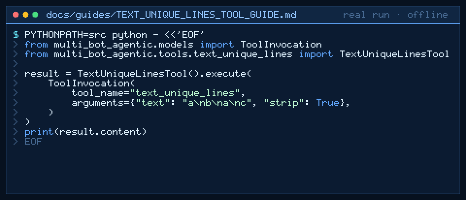

# text_unique_lines Tool Guide



Deduplicate noisy lines in first-seen order before the next GPT-6 Astra /
Claude Opus 5.5 / Gemini 4 Argon / Kimi K3.1 Pro turn.

## Why

Agent traces and scraped candidate lists often repeat lines. Unlike
`text_sort_lines` with `unique=true`, this tool preserves original order —
matching the dedupe helpers popular agent frameworks expose for logs.

## Usage

```python
tool.execute(
    ToolInvocation(
        tool_name="text_unique_lines",
        arguments={"text": "a\nb\na\nc", "strip": True},
    )
)
```

Sentinel form: `text<<<TEXT_UNIQUE_LINES>>>false`

## Bounds & Safety

- Max 20_000 input/output chars
- `strip` default true (compare after strip)
- Never executes code or makes network requests
