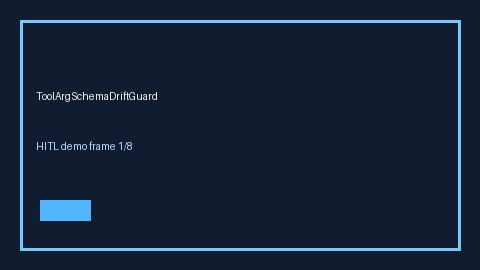

# ToolArgSchemaDriftGuard Guide



Offline HITL guard. Never network I/O. Closes gaps vs AutoGen/CrewAI/LangGraph tool-argument schema-drift guards.

Optional polish via **GPT-5.5 / Claude Sonnet 4.6 / Gemini 3.x / Kimi K2**.

Distinct from `SchemaValidate` / `ToolResultSizeBombGuard`.

## Usage

```python
from multi_bot_agentic.tool_arg_schema_drift import ToolArgSchemaDriftGuard

status = ToolArgSchemaDriftGuard().check("s1", schema_drift_score=0.0750)
assert status.requires_human_review is True
print(status.band)
```

## Safety

Always `requires_human_review=True`. No HTTP. Humans decide.
