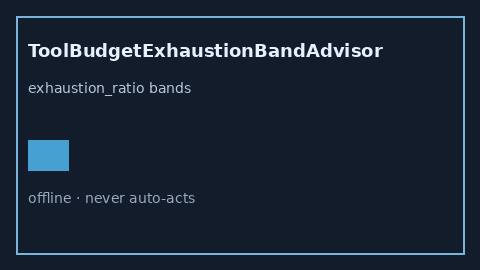

# ToolBudgetExhaustionBandAdvisor Guide



Offline HITL helper for `exhaustion_ratio` bands.
Gap vs LangGraph/CrewAI/AutoGen tool budget-exhaustion monitors. Distinct from `ToolCallQuotaGuard` / `ToolRetryBudgetBandGuard`.

Stack: **GPT-5.5 / Claude Sonnet 4.6 / Gemini 3.x / Kimi K2**.

## Usage

```python
from multi_bot_agentic.tool_budget_exhaustion_band import ToolBudgetExhaustionBandAdvisor

status = ToolBudgetExhaustionBandAdvisor().advise("s1", exhaustion_ratio=0.4)
assert status.requires_human_review is True
print(status.band)
```

## Safety

Advisory only. No network I/O. Never auto-acts. Humans decide.
