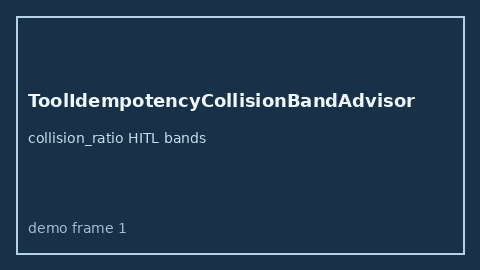

# ToolIdempotencyCollisionBandAdvisor Guide



Offline HITL `collision_ratio` bands.
Gap vs LangGraph/CrewAI/AutoGen tool idempotency-collision monitors. Distinct from `ToolSideEffectReplayBandAdvisor` / `ToolResultSchemaDriftBandAdvisor`.

Stack: **GPT-5.5 / Claude Sonnet 4.6 / Gemini 3.x / Kimi K2**.

## Usage

```python
from multi_bot_agentic.tool_idempotency_collision_band import ToolIdempotencyCollisionBandAdvisor

status = ToolIdempotencyCollisionBandAdvisor().advise("s1", collision_ratio=0.8)
assert status.requires_human_review is True
print(status.band)
```

## Safety

Advisory only. No network I/O. Never auto-acts.
