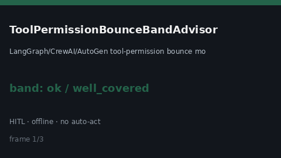

# ToolPermissionBounceBandAdvisor Guide



HITL `bounce_ratio` band guard.
Gap vs LangGraph/CrewAI/AutoGen tool-permission bounce monitors. Distinct from `ToolPermissionEscalationBandAdvisor` / `ToolSandboxEscapeAttemptBandAdvisor`.

Stack: **GPT-6 Astra / Claude Opus 5.5 / Gemini 4 Argon / Kimi K3.1 Pro**.

## Usage

```python
from multi_bot_agentic.tool_permission_bounce_band import ToolPermissionBounceBandAdvisor

status = ToolPermissionBounceBandAdvisor(soft_limit=0.2, hard_limit=0.5).advise(
    "sess-1",
    bounce_ratio=0.35,
)
print(status.band, status.requires_human_review)
```

## Safety

Advisory only. No network I/O. Never auto-acts. Humans decide.
