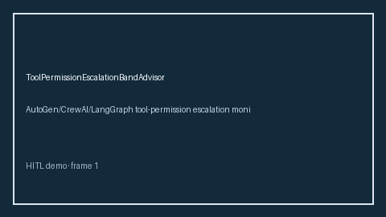

# ToolPermissionEscalationBandAdvisor Guide



Offline HITL guard. Never network I/O. Closes gaps vs AutoGen/CrewAI/LangGraph tool-permission escalation monitors.

Optional polish via **GPT-5.5 / Claude Sonnet 4.6 / Gemini 3.x / Kimi K2**.

Distinct from `ToolPermissionAllowlist` / `AgentCapabilityRevocationBandAdvisor`.

## Usage

```python
from multi_bot_agentic.tool_permission_escalation_band import ToolPermissionEscalationBandAdvisor

status = ToolPermissionEscalationBandAdvisor().advise("s1", escalation_score=0.3000)
assert status.requires_human_review is True
print(status.band)
```

## Safety

Always `requires_human_review=True`. No HTTP. Humans decide.
