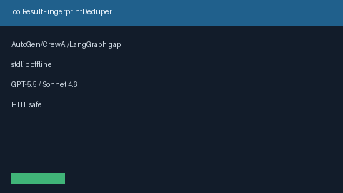

# ToolResultFingerprintDeduper Guide

Fingerprint-hash tool-result dedupe per session to avoid re-injecting identical observations (never network I/O)

Works with **GPT-6 Astra / Claude Opus 5.5 / Gemini 4 Argon / Kimi K3.1 Pro**.

## Gap vs AutoGen / CrewAI / LangGraph / Semantic Kernel

| Capability | multi-bot-agentic | Popular frameworks |
| --- | --- | --- |
| Focus | ToolResultFingerprintDeduper | Often missing or proprietary |

## Usage

See unit tests under `tests/` for caller-driven examples. Never performs network I/O.
