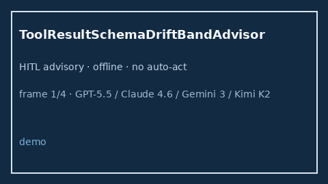

# ToolResultSchemaDriftBandAdvisor Guide



Offline HITL `drift_ratio` bands.
Gap vs LangGraph/CrewAI/AutoGen tool-result schema-drift monitors. Distinct from `ToolArgSchemaDriftGuard` / `ToolResultSchemaLagAdvisor`.

Stack: **GPT-5.5 / Claude Sonnet 4.6 / Gemini 3.x / Kimi K2**.

## Usage

```python
from multi_bot_agentic.tool_result_schema_drift_band import ToolResultSchemaDriftBandAdvisor

status = ToolResultSchemaDriftBandAdvisor().advise("session-1", drift_ratio=0.4)
assert status.requires_human_review is True
print(status.band)
```

## Safety

Advisory only. No network I/O. Never auto-acts.
