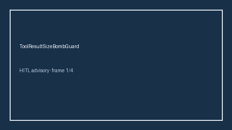

# ToolResultSizeBombGuard Guide



Offline HITL guard. Never network I/O. Closes gaps vs AutoGen/CrewAI/LangGraph tool-result size-bomb guards.

Optional polish via **GPT-5.5 / Claude Sonnet 4.6 / Gemini 3.x / Kimi K2**.

Distinct from `ToolArgByteBudgetGuard` / `ToolResultPoisoningGuard`.

## Usage

```python
from multi_bot_agentic.tool_result_size_bomb import ToolResultSizeBombGuard

status = ToolResultSizeBombGuard().check("s1", result_bytes=0.1)
assert status.requires_human_review is True
print(status.band)
```

## Safety

Always `requires_human_review=True`. No HTTP. Humans decide.
