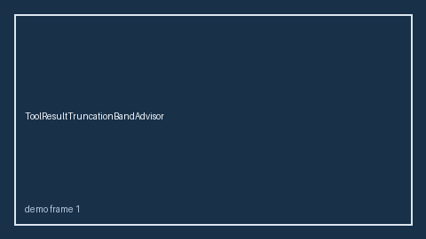

# ToolResultTruncationBandAdvisor Guide



HITL band advisor for `truncation_ratio`.
Gap vs LangGraph/CrewAI/AutoGen tool-result truncation monitors. Distinct from `ToolResultSchemaDriftBandAdvisor` / `ToolBudgetExhaustionBandAdvisor`.

Stack: **GPT-5.5 / Claude Sonnet 4.6 / Gemini 3.x / Kimi K2**.

## Usage

```python
from multi_bot_agentic.tool_result_truncation_band import ToolResultTruncationBandAdvisor

status = ToolResultTruncationBandAdvisor().advise("session-1", truncation_ratio=0.3)
assert status.requires_human_review is True
print(status.band)
```

## Safety

Advisory only. No network I/O. Humans decide.
