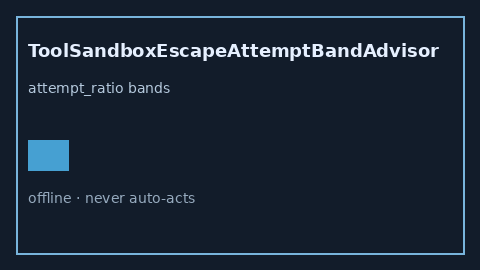

# ToolSandboxEscapeAttemptBandAdvisor Guide



Offline HITL helper for `attempt_ratio` bands.
Gap vs LangGraph/CrewAI/AutoGen tool sandbox-escape attempt monitors. Distinct from `ToolResultSchemaDriftBandAdvisor` / `ToolPermissionEscalationBandAdvisor`.

Stack: **GPT-5.5 / Claude Sonnet 4.6 / Gemini 3.x / Kimi K2**.

## Usage

```python
from multi_bot_agentic.tool_sandbox_escape_attempt_band import ToolSandboxEscapeAttemptBandAdvisor

status = ToolSandboxEscapeAttemptBandAdvisor().advise("s1", attempt_ratio=0.4)
assert status.requires_human_review is True
print(status.band)
```

## Safety

Advisory only. No network I/O. Never auto-acts. Humans decide.
