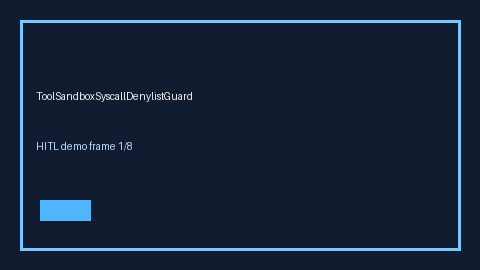

# ToolSandboxSyscallDenylistGuard Guide



Offline HITL guard. Never network I/O. Closes gaps vs AutoGen/CrewAI/LangGraph tool-sandbox syscall denylist guards.

Optional polish via **GPT-5.5 / Claude Sonnet 4.6 / Gemini 3.x / Kimi K2**.

Distinct from `ToolSandboxEgressGuard` / `ToolSandboxNetworkExfilGuard`.

## Usage

```python
from multi_bot_agentic.tool_sandbox_syscall_denylist import ToolSandboxSyscallDenylistGuard

status = ToolSandboxSyscallDenylistGuard().check("s1", denied_syscall_rate=0.0250)
assert status.requires_human_review is True
print(status.band)
```

## Safety

Always `requires_human_review=True`. No HTTP. Humans decide.
