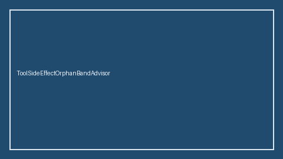

# ToolSideEffectOrphanBandAdvisor Guide



HITL `orphan_ratio` band guard.
Gap vs LangGraph/CrewAI/AutoGen tool side-effect orphan monitors. Distinct from `ToolSideEffectLedgerAdvisor` / `ToolSideEffectReplayBandAdvisor`.

Stack: **GPT-5.5 / Claude Sonnet 4.6 / Gemini 3.x / Kimi K2**.

## Usage

```python
from multi_bot_agentic.tool_side_effect_orphan_band import ToolSideEffectOrphanBandAdvisor

status = ToolSideEffectOrphanBandAdvisor(soft_limit=0.2, hard_limit=0.5).advise(
    "sess-1",
    orphan_ratio=0.35,
)
print(status.band, status.requires_human_review)
```

## Safety

Advisory only. No network I/O. Never auto-acts. Humans decide.
