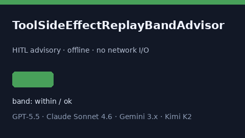

# ToolSideEffectReplayBandAdvisor Guide



Offline HITL helper for `replay_ratio` bands.
Gap vs LangGraph/CrewAI/AutoGen tool side-effect replay monitors. Distinct from `ToolTimeoutCascadeBandAdvisor` / `ActorMailboxOverflowAdvisor`.

Optional polish via **GPT-5.5 / Claude Sonnet 4.6 / Gemini 3.x / Kimi K2**.

## Usage

```python
from multi_bot_agentic.tool_side_effect_replay_band import ToolSideEffectReplayBandAdvisor

status = ToolSideEffectReplayBandAdvisor().advise("session-1", replay_ratio=0.4)
assert status.requires_human_review is True
print(status.band)
```

## Safety

Advisory only. No network I/O. Never auto-acts. Humans decide.
