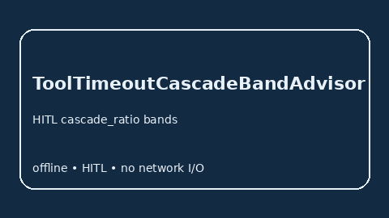

# ToolTimeoutCascadeBandAdvisor Guide



Offline HITL `cascade_ratio` bands. Gap vs LangGraph/CrewAI/AutoGen tool-timeout cascade monitors. Distinct from `HandoffTimeoutBandAdvisor` / `CriticTimeoutBandAdvisor`.

Optional polish via **GPT-5.5 / Claude Sonnet 4.6 / Gemini 3.x / Kimi K2**.

## Usage

```python
from multi_bot_agentic.tool_timeout_cascade_band import ToolTimeoutCascadeBandAdvisor

status = ToolTimeoutCascadeBandAdvisor().advise("s1", cascade_ratio=0.3)
assert status.requires_human_review is True
print(status.band)
```

## Safety

Advisory only. No network I/O. Humans decide.
