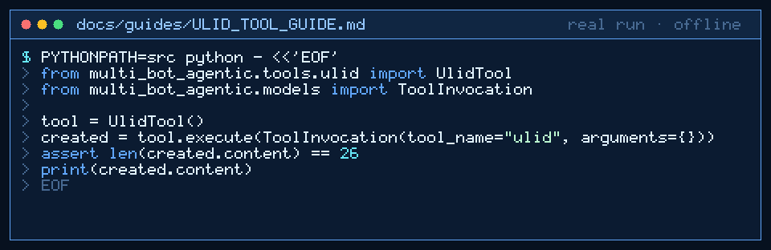

# ULID Tool Guide



Deterministic Crockford-Base32 ULID generate/validate for GPT-6 Astra / Claude Opus 5.5 / Gemini 4 Argon / Kimi K3.1 Pro workers.

## Why

Models invent UUID-like strings that are not sortable. This tool generates and validates ULIDs with no network. Inspired by ID helpers in popular agent/tool runtimes (CrewAI/LangChain community utilities).

## Usage

```python
from multi_bot_agentic.tools.ulid import UlidTool
from multi_bot_agentic.models import ToolInvocation

tool = UlidTool()
created = tool.execute(ToolInvocation(tool_name="ulid", arguments={}))
assert len(created.content) == 26
print(created.content)
```

## Bounds

- Max 2000 characters (validate mode)
- Modes: `generate` (default), `validate`
- Alphabet: Crockford Base32 (length 26)

## Safety

Allowlisted; no network; uses OS randomness for the 80-bit entropy segment.
