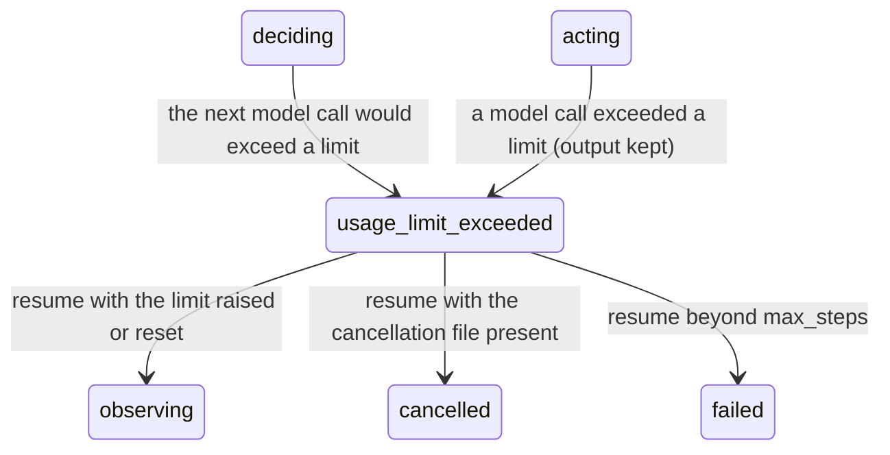

# Usage Limits Guide: token usage, cost accounting, and hard usage limits

Every model call a run makes now records the tokens the provider reported and what the call cost, as a durable
`llm_usage` event in the event log. `--max-requests`, `--max-input-tokens`, `--max-output-tokens`,
`--max-total-tokens`, and `--max-cost-usd` bound a run's model usage. A limit is checked before every model call
and again after it. A breach stops the run in the resumable `usage_limit_exceeded` state (exit code 5), and
`resume` with a higher limit continues exactly where it stopped. `report`, `replay`, `history`, `trace`, `fork`,
and `eval` all show the usage.


## Contents

- [Why](#why)
- [Prerequisites](#prerequisites)
- [Quickstart](#quickstart)
- [How it works](#how-it-works)
- [CLI reference](#cli-reference)
- [Event reference](#event-reference)
- [Provider usage mapping](#provider-usage-mapping)
- [Price table](#price-table)
- [Python API](#python-api)
- [Worked examples](#worked-examples)
- [How it interacts with other features](#how-it-interacts-with-other-features)
- [Safety and limitations](#safety-and-limitations)
- [Troubleshooting](#troubleshooting)
- [FAQ](#faq)
- [How the demo was recorded](#how-the-demo-was-recorded)
- [Related](#related)

## Why

Step budgets (`--max-steps`) and timeouts bound how long a run takes, but not what it spends. A run that loops on a
large context can burn through millions of tokens within six steps, and before this feature the adapters dropped
the providers' usage blocks, so a run could not even say what it had cost. Popular agent frameworks treat usage as
a first-class runtime concern:

| Project | What it offers | What this repository lacked |
| --- | --- | --- |
| [OpenAI Agents SDK usage tracking](https://openai.github.io/openai-agents-python/usage/) | `Usage` per run: requests, input/output/total tokens, cached and reasoning token details | Adapters returned only text; usage was never recorded |
| [Pydantic AI `UsageLimits`](https://ai.pydantic.dev/agents/#usage-limits) | `request_limit`, `input_tokens_limit`, `output_tokens_limit`, `total_tokens_limit` (and a cost limit), checked before each request and after each response, raising `UsageLimitExceeded` | No way to bound a run in tokens or dollars |
| [OpenTelemetry GenAI semantic conventions](https://opentelemetry.io/docs/specs/semconv/gen-ai/) | `gen_ai.usage.input_tokens`, `gen_ai.usage.output_tokens`, cache and reasoning token attributes on model-call spans | `trace` exported model-call spans without usage |
| [Langfuse token and cost tracking](https://langfuse.com/docs/observability/features/token-and-cost-tracking) / [LangSmith cost tracking](https://docs.langchain.com/langsmith/cost-tracking) | Model price tables (with custom and effective-dated prices), cost per call and per trace | `report` could not say what a run cost |

What this repository adds on top of them, because its runs are durable and resumable:

- **The stop is a state, not an exception.** A Pydantic AI `UsageLimitExceeded` ends the run. Here the run stops
  in `usage_limit_exceeded` with a checkpoint, and `resume --max-total-tokens <higher>` continues it. The output of a
  call that crossed the limit is kept, so that call is never paid for twice.
- **Totals survive processes.** Running totals are the sum of the run's `llm_usage` events, so `resume` continues
  them, and a `fork` starts from the totals at its fork point.
- **Limits never silently stop working.** A limit that the run cannot measure (the provider reported no tokens, or
  the model has no price) counts as breached instead of being ignored.

## Prerequisites

- Python 3.10+ and the package installed: `python -m pip install -e ".[dev]"`.
- Nothing else for the offline quickstart: the fake provider reports deterministic usage (about four characters
  per token) and costs $0. `MULTIBOT_FAKE_MODEL=gpt-6.2-sol` prices that usage as GPT-6.2 Sol, so cost limits can be
  rehearsed offline.
- For real models: an API key for OpenAI (GPT-6.2 Sol or Astra), Gemini (Gemini 4 Neon, Hydrogen, or Carbon), or
  Kimi (Kimi K3.1 Pro), or the Claude Code CLI with `--output-format json` (Claude Opus 5.5 and friends) so that it
  reports usage and cost. See [Configuration](../CONFIGURATION.md).

## Quickstart

```bash
# 1. A run that stops at its token limit after a model call (exit code 5)
multi-bot-agentic run --goal "Create a launch checklist" --provider fake \
  --event-log demo-output/usage.sqlite --run-id demo --max-total-tokens 150

# 2. What each model call used and cost
multi-bot-agentic replay --event-log demo-output/usage.sqlite --run-id demo --event-type llm_usage --format text

# 3. Resuming without raising the limit repeats the stop and writes nothing (exit 5) ...
multi-bot-agentic resume --run-id demo --event-log demo-output/usage.sqlite
# ... a higher limit continues where the run stopped (exit 0)
multi-bot-agentic resume --run-id demo --event-log demo-output/usage.sqlite --max-total-tokens 1000

# 4. A cost limit, with the fake provider's usage priced as GPT-6.2 Sol
MULTIBOT_FAKE_MODEL=gpt-6.2-sol multi-bot-agentic run --goal "Create a launch checklist" --provider fake \
  --event-log demo-output/usage.sqlite --run-id priced --max-cost-usd 0.0003

# 5. Usage and cost per run, per bot, and per model, plus totals across runs
multi-bot-agentic report --event-log demo-output/usage.sqlite

# 6. Usage on the OpenTelemetry spans and in the Mermaid diagram
multi-bot-agentic trace --event-log demo-output/usage.sqlite --run-id priced --format mermaid
```

The first command prints two notes on stderr and the stopped run on stdout:

```text
note: run demo stopped at a usage limit: total_tokens=202 exceeded max_total_tokens=150
note: continue: resume --run-id demo --event-log demo-output/usage.sqlite and raise it with --max-total-tokens <N>
```

## How it works

### Per-call accounting

1. Each adapter parses its provider's own usage block into a normalized `Usage` (requests, input, output, cached
   input, reasoning, and total tokens). A counter the provider did not report stays `null`, never `0`. Following the
   OpenTelemetry GenAI conventions, input tokens include cached input tokens and output tokens include reasoning
   tokens. See [Provider usage mapping](#provider-usage-mapping).
2. As soon as the provider returns, the runner prices the call: a cost the provider reported itself (Claude Code's
   `total_cost_usd`) wins, otherwise the [price table](#price-table) prices the model at the UTC day of the call.
   A model without a price is *unpriced*: its cost is `null` with a note saying why, never a guess.
3. The runner appends an `llm_usage` event (bot, provider, model, usage, cost, `priced_at`, and the run's running
   totals) right before the call's `action_result`, so a call that was paid for is recorded even if the process
   dies before its result is.

The run's totals are always the sum of its `llm_usage` events. Nothing else stores them, so they cannot disagree
with the log: `resume` rebuilds them from the run's events, and a fork, whose inherited events include the
source run's `llm_usage` events up to the fork point, starts from the source's totals at that point.

### Limits

Limits cap five running totals:

| Flag | Caps | Before a model call, the run stops when | After a model call, the run stops when |
| --- | --- | --- | --- |
| `--max-requests N` | model calls | `requests >= N` (the call would be one too many) | `requests > N` |
| `--max-input-tokens N` | input tokens (cached included) | `input_tokens >= N` | `input_tokens > N` |
| `--max-output-tokens N` | output tokens (reasoning included) | `output_tokens >= N` | `output_tokens > N` |
| `--max-total-tokens N` | total tokens | `total_tokens >= N` | `total_tokens > N` |
| `--max-cost-usd USD` | cost in USD | `cost_usd >= USD` | `cost_usd > USD` |

Before a call the totals can only grow, so reaching a limit already blocks the next call; reaching it exactly with
a call is allowed. Limits gate model calls only: tool calls, handoffs, and the final answer never consume model
tokens. A limit is *unmeasurable* when a call reported no tokens (for token limits) or has no cost (for
`--max-cost-usd`); an unmeasurable limit counts as breached, with `value: null`, so it never silently stops
working.

A breach stops the run:



- **Before the call** the stop happens before the `decision` event is recorded, so the stopped step stays a clean
  fork point and `resume` decides it again.
- **After the call** the call's `llm_usage`, `action_result`, and step checkpoint are written first, so `resume`
  continues with that output and the call is never repeated.
- Either way the runner writes a `state_transition` to `usage_limit_exceeded`, a `usage_limit_exceeded` event that
  names the limit, its value, and its cap, and a checkpoint in that state. The command exits with code 5.

### Resume and fork

- Limits are recorded in `run_created` and in every checkpoint, so they stay in force: `resume` without flags keeps
  the run's recorded limits, and every `--max-*` flag replaces the recorded value of that limit (raise it, or lower
  it). `--reset-usage-limits` drops the recorded limits, so only the command's own flags apply.
- While the limit that stopped the run still holds, `resume` returns the stop again, writes nothing, and exits 5
  (`"resumed": false`). Once the limit is raised, it continues from the stop.
- `fork --at-step N` starts from the totals at step `N` and inherits the limits recorded at step `N`, so a fork
  counts its inherited usage against its limits. Its own `--max-*` flags replace inherited limits, and
  `--reset-usage-limits` drops them.

## CLI reference

### Limit flags (`run`, `resume`, `fork`)

| Flag | Value | Default | Notes |
| --- | --- | --- | --- |
| `--max-requests` | integer >= 0 | unlimited | Model calls of the run (a fork counts its inherited calls) |
| `--max-input-tokens` | integer >= 0 | unlimited | Input tokens, cached tokens included |
| `--max-output-tokens` | integer >= 0 | unlimited | Output tokens, reasoning tokens included |
| `--max-total-tokens` | integer >= 0 | unlimited | Total tokens |
| `--max-cost-usd` | number >= 0 (USD) | unlimited | Needs every call priced (price table, `MULTIBOT_PRICES_FILE`, or provider-reported cost) |
| `--reset-usage-limits` | flag (`resume`, `fork`) | off | Drop the limits recorded in the run (`resume`) or at the fork point (`fork`) |

`0` is a valid limit: `--max-total-tokens 0` allows no model call at all. Negative or non-numeric values are
rejected by the argument parser (exit code 2) before anything is written.

### Exit codes

| Code | `run`, `resume`, `fork` |
| --- | --- |
| 0 | The run succeeded (or `fork --dry-run` passed) |
| 2 | The run failed or was cancelled, or the command was refused (bad flags, unknown run, invalid price file, ...) |
| 3 | The run is paused at a human-approval interrupt ([HITL guide](HITL_INTERRUPTS_GUIDE.md)) |
| 4 | The final answer never validated against `--output-schema` ([Structured Output Guide](STRUCTURED_OUTPUT_GUIDE.md)) |
| 5 | A usage limit stopped the run, or `resume` found it still over that limit (nothing written) |
| 75 | Another live process is continuing the run; nothing was written |

### Output

`run`, `resume`, and `fork` print the run's running `usage` totals; a stopped run also has `usage_limit`:

```json
{
  "run_id": "demo",
  "state": "usage_limit_exceeded",
  "answer": "stopped: total_tokens=202 exceeded max_total_tokens=150",
  "steps": 3,
  "event_log": "demo-output/guide/runs.sqlite",
  "usage": {
    "requests": 2,
    "input_tokens": 181,
    "output_tokens": 21,
    "cached_input_tokens": 0,
    "reasoning_tokens": 0,
    "total_tokens": 202,
    "cost_usd": 0.0,
    "unmeasured_requests": 0,
    "unpriced_requests": 0
  },
  "usage_limit": {
    "limit": "max_total_tokens",
    "counter": "total_tokens",
    "value": 202,
    "cap": 150,
    "phase": "after_call",
    "message": "total_tokens=202 exceeded max_total_tokens=150"
  }
}
```

| Field | Meaning |
| --- | --- |
| `usage.requests` | Model calls (a fork's include the calls it inherited) |
| `usage.<counter>` | Sum over the calls that reported the counter; `null` until one does |
| `usage.cost_usd` | Sum over the priced calls; `null` until one is priced |
| `usage.unmeasured_requests` | Calls that reported no input or output tokens (the token sums are then partial) |
| `usage.unpriced_requests` | Calls without a cost (the cost sum is then partial) |
| `usage_limit.phase` | `before_call` (the next call would exceed the limit) or `after_call` (a call exceeded it) |
| `usage_limit.value` | The total when the run stopped; `null` when the limit could not be measured |

On a stop, stderr says which limit stopped the run and how to continue (`raise it with --max-total-tokens <N>`, or
`drop it with --reset-usage-limits` for a limit that cannot be measured). `fork --dry-run` adds a `usage` object
with the `inherited` totals and the effective `limits` when either is non-empty.

### Inspecting usage

| Command | What it shows |
| --- | --- |
| `replay --event-type llm_usage --format text` | One row per model call: provider, model, input/output tokens, cost (`(provider)` when provider-reported, `unpriced` when unknown) |
| `replay --event-type usage_limit_exceeded --format text` | Each stop: limit, value, cap, phase, and step |
| `report` | Per run: `usage` with the run's own totals, `by_bot` and `by_model` rows, a fork's `inherited` and `running` totals, and `limit_stops`. Top level: `usage_totals`, the sum of every run's own calls, so a call a fork inherited is counted once |
| `history` | `stopped at a usage limit after N steps` for a stopped run |
| `trace` (OTLP/JSON) | `gen_ai.usage.input_tokens`, `gen_ai.usage.output_tokens`, `gen_ai.usage.cache_read.input_tokens`, `gen_ai.usage.reasoning.output_tokens`, `multi_bot_agentic.usage.cost_usd`, and `multi_bot_agentic.usage.priced_model` on each model-call span; sums and total cost on the root span; a `multi_bot_agentic.usage_limit_exceeded` span event per stop |
| `trace --format mermaid` | A `usage: <in> in / <out> out tokens, $<cost>` note after each model call, a note per stop, and `stopped: usage limit exceeded` as the closing note |
| `eval` | `usage` per scenario, `budget_checks` for scenarios with budgets, and `usage_totals` across scenarios |

### Eval budgets

Scenario fixtures accept three optional fields:

| Field | Type | Meaning |
| --- | --- | --- |
| `max_total_tokens` | integer >= 0 | The scenario fails when the run's total tokens exceed it, or are unknown |
| `max_cost_usd` | number >= 0 | The scenario fails when the run's cost exceeds it, or is unknown (unpriced) |
| `model` | string | Model id the offline usage is priced as (default `fake`, which costs $0) |

The packaged [`usage_budget.json`](../../src/multi_bot_agentic/eval/fixtures/usage_budget.json) prices its scripted
run as `gpt-6.2-sol` and asserts both budgets. Budgets are assertions on the finished run, not runtime limits.

## Event reference

### `llm_usage`

Appended once per model call, after the provider returned and before the call's `action_result`. `replay`
prints it as JSON (keys sorted):

```json
{
  "event_type": "llm_usage",
  "payload": {
    "bot": null,
    "cost": {
      "rate": {
        "cached_input": 0.0,
        "effective_from": null,
        "input": 0.0,
        "model": "fake",
        "output": 0.0,
        "source": "offline fake provider",
        "verified": "2026-11-26"
      },
      "source": "price_table",
      "usd": 0.0
    },
    "model": "fake",
    "priced_at": "2026-11-27",
    "provider": "fake",
    "totals": {
      "cached_input_tokens": 0,
      "cost_usd": 0.0,
      "input_tokens": 54,
      "output_tokens": 10,
      "reasoning_tokens": 0,
      "requests": 1,
      "total_tokens": 64,
      "unmeasured_requests": 0,
      "unpriced_requests": 0
    },
    "usage": {
      "cached_input_tokens": 0,
      "input_tokens": 54,
      "output_tokens": 10,
      "reasoning_tokens": 0,
      "requests": 1,
      "total_tokens": 64
    }
  },
  "run_id": "demo",
  "seq": 8,
  "state": "acting",
  "timestamp": "2026-11-27T19:45:18.218959+00:00"
}
```

| Key | Meaning |
| --- | --- |
| `bot` | Bot active during the call (`null` without bots) |
| `provider`, `model` | Adapter and the model id the call was priced as (`null` when the adapter does not know it) |
| `usage` | The call's normalized usage, or `null` when the provider reported none |
| `cost.usd` | The call's cost, or `null` when unpriced |
| `cost.source` | `provider` (reported by the provider), `price_table`, or `unpriced` |
| `cost.rate` | Applied USD-per-1M rates, their `source`, `effective_from`, and the day the built-in price was `verified` (`null` for price-file entries) |
| `cost.notes` | Why a call is unpriced, or what the computation assumed (long-context rates, cached tokens priced at the input rate) |
| `priced_at` | UTC day whose prices applied. Payloads hold no wall-clock time (the event's own timestamp does), so fake-provider logs stay deterministic |
| `totals` | The run's running totals after this call, for reading the log; the runner sums `usage` and `cost.usd` instead |

### `usage_limit_exceeded`

```json
{"cap":150,"counter":"total_tokens","limit":"max_total_tokens","limits":{"max_total_tokens":150},"message":"total_tokens=202 exceeded max_total_tokens=150","phase":"after_call","step":3,"totals":{"cached_input_tokens":0,"cost_usd":0.0,"input_tokens":181,"output_tokens":21,"reasoning_tokens":0,"requests":2,"total_tokens":202,"unmeasured_requests":0,"unpriced_requests":0},"value":202}
```

`step` is the 1-based step of the model call that was blocked (`before_call`) or that exceeded the limit
(`after_call`); `limits` are all limits in force; `unknown_calls` is added when `value` is `null`. The checkpoint
that follows it is in state `usage_limit_exceeded`.

### Limits in `run_created` and checkpoints

`run_created` and every checkpoint carry `"usage_limits": {"max_total_tokens": 150, ...}` when any limit is set.
That is how `resume` and `fork` know the limits a run was started with.

## Provider usage mapping

| Adapter | Provider field | `input_tokens` | `output_tokens` | `cached_input_tokens` | `reasoning_tokens` | Cost |
| --- | --- | --- | --- | --- | --- | --- |
| `openai` (Chat Completions) | `usage` | `prompt_tokens` | `completion_tokens` | `prompt_tokens_details.cached_tokens` | `completion_tokens_details.reasoning_tokens` | price table (`OPENAI_MODEL`) |
| OpenAI Responses shape (compatible endpoints) | `usage` | `input_tokens` | `output_tokens` | `input_tokens_details.cached_tokens` | `output_tokens_details.reasoning_tokens` | price table |
| `kimi` | `usage` (OpenAI-compatible) | `prompt_tokens` | `completion_tokens` | `prompt_tokens_details.cached_tokens` | `completion_tokens_details.reasoning_tokens` | price table (`KIMI_MODEL`) |
| `gemini` | `usageMetadata` | `promptTokenCount` + `toolUsePromptTokenCount` | `candidatesTokenCount` + `thoughtsTokenCount` | `cachedContentTokenCount` | `thoughtsTokenCount` | price table (`GEMINI_MODEL`) |
| `claude_code` with `--output-format json` | `modelUsage` (falls back to `usage`) | `inputTokens` + `cacheReadInputTokens` + `cacheCreationInputTokens` | `outputTokens` | `cacheReadInputTokens` | not reported (`null`) | `total_cost_usd`, reported by Claude Code |
| `claude_code` plain text | none | `null` | `null` | `null` | `null` | unpriced |
| `fake` and eval `scripted` | deterministic | 40 + ceil(prompt characters / 4) | ceil(reply characters / 4) | `0` | `0` | price table (`MULTIBOT_FAKE_MODEL`, default `fake` at $0) |

`total_tokens` is the provider's total when it reports one (`total_tokens`, `totalTokenCount`), otherwise input
plus output. Gemini omits zero counts from `usageMetadata`, so a count missing from a present `usageMetadata` is
`0`; a response without `usageMetadata` has unknown usage. Claude Code's `modelUsage` includes subagent calls,
which its top-level `usage` leaves out.

## Price table

USD per 1M tokens at the Standard tier, verified on 2026-11-26. Only model ids the adapters document are listed:

| Model | Input | Cached input | Output | Notes | Source |
| --- | --- | --- | --- | --- | --- |
| `gpt-6.2-sol` | $2.00 | $0.10 | $10.00 | More than 272,000 input tokens: 2x input and cached, 1.5x output for the whole request | [OpenAI pricing](https://developers.openai.com/api/docs/pricing) |
| `gpt-6.2-astra` | $8.00 | $0.40 | $40.00 | Same long-context rule | [OpenAI pricing](https://developers.openai.com/api/docs/pricing) |
| `gemini-4-neon` | $3.00 | $0.15 | $15.00 | Paid tier only | [Gemini 4 Neon](https://aistudio.google.com/docs/models/gemini-4-neon) |
| `gemini-4-hydrogen` | $1.50 | n/a | $7.50 | Paid-tier rates (the free tier is not billed) | [Gemini changelog](https://aistudio.google.com/docs/changelog) |
| `gemini-4-carbon` | $2.00, then $4.00 | n/a | $10.00, then $20.00 | Introductory price through 2026-11-30; list price from 2026-12-01 (by the call's UTC day) | [Gemini changelog](https://aistudio.google.com/docs/changelog) |
| `kimi-k3.1-pro` | $2.00 | n/a | $10.00 | | [Kimi K3.1 Pro pricing](https://www.kimi.ai/resources/kimi-k3-1-pro-pricing) |
| `fake` | $0 | $0 | $0 | The offline fake provider is never billed | |

- **Unpriced models** (for example the Gemini default `gemini-3.8-flash`, `gpt-6.1-terra`, `gpt-6-luna`,
  `kimi-k3.1-pro-highspeed`) get `cost.usd: null` and the note `no price for model '<id>' in the price table`.
- **No cached-input rate** ("n/a"): cached tokens are priced at the input rate, an upper bound, with a note.
- **Claude models** are not in the table: Claude Code reports its own `total_cost_usd` in JSON mode, which is used as
  is (`cost.source: provider`). Claude Code calls that estimate client-side and can differ from the bill.
- **Batch, Flex, Priority, and background-mode discounts** are not modeled: the adapters send Standard requests.

### Custom prices: `MULTIBOT_PRICES_FILE`

Point `MULTIBOT_PRICES_FILE` at a JSON file to add models or replace built-in prices (for example negotiated
rates). Each entry needs `input` and `output` (USD per 1M tokens); `cached_input`, `source`, and `vendor` are
optional:

```json
{
  "models": {
    "gemini-3.8-flash": {"input": 0.5, "output": 3.0, "cached_input": 0.05, "source": "example: negotiated rate"},
    "gpt-6.2-sol": {"input": 1.6, "output": 8.0, "cached_input": 0.08, "source": "example: enterprise discount"}
  }
}
```

An entry from the file replaces the built-in entry of the same model entirely (including its long-context rule).
`run`, `resume`, and `fork` refuse an unreadable file or an invalid entry with exit code 2 before anything is
written.

## Python API

```python
from pathlib import Path

from multi_bot_agentic.event_log import SQLiteEventLog
from multi_bot_agentic.llm import FakeLLMAdapter
from multi_bot_agentic.runner import AgentRunner, build_default_tools
from multi_bot_agentic.safety import SafetyPolicy
from multi_bot_agentic.usage import UsageLimits

log = SQLiteEventLog(Path("demo-output/api.sqlite"))
tools = build_default_tools(Path.cwd())
provider = FakeLLMAdapter(model="gpt-6.2-sol")  # deterministic usage, priced as GPT-6.2 Sol

capped = AgentRunner(provider, log, tools, SafetyPolicy(usage_limits=UsageLimits(max_requests=1)))
stopped = capped.run("Create a launch checklist", run_id="api-demo")
print(stopped.state.value, "|", stopped.answer)

raised = AgentRunner(provider, log, tools, SafetyPolicy(usage_limits=UsageLimits(max_requests=5)))
done = raised.resume("api-demo")
assert done.usage is not None
print(done.state.value, "|", done.usage.requests, "calls |", done.usage.total_tokens, "tokens |", done.usage.cost_usd)
log.close()
```

Output:

```text
usage_limit_exceeded | stopped: the next model call would exceed max_requests=1 (requests=1)
succeeded | 2 calls | 202 tokens | 0.000572
```

| Name | Module | Purpose |
| --- | --- | --- |
| `UsageLimits` | `multi_bot_agentic.usage` | `max_requests`, `max_input_tokens`, `max_output_tokens`, `max_total_tokens`, `max_cost_usd`; set it as `SafetyPolicy(usage_limits=...)` |
| `UsageTotals` | `multi_bot_agentic.usage` | Running totals; `UsageTotals.from_events(events)` sums a run's `llm_usage` events |
| `LimitBreach` | `multi_bot_agentic.usage` | `RunResult.usage_limit` of a stopped run: `limit`, `counter`, `value`, `cap`, `phase`, `message` |
| `usage_summary` | `multi_bot_agentic.usage` | The `report` usage section of one run |
| `Usage` | `multi_bot_agentic.models` | Normalized usage of one call (`ModelOutput.usage`) |
| `PriceTable`, `price_call` | `multi_bot_agentic.pricing` | Built-in prices (`PriceTable.load(path)` adds a price file) and per-call pricing |
| `AgentRunner(..., price_table=...)` | `multi_bot_agentic.runner` | Prices used for `llm_usage` costs (default: built-in) |
| `RunResult.usage`, `.usage_limit`, `.still_stopped` | `multi_bot_agentic.runner` | Running totals, the breach, and whether `resume` found the run still over its limit |
| `resume(run_id, reset_usage_limits=True)`, `fork(..., reset_usage_limits=True)` | `multi_bot_agentic.runner` | Drop recorded limits |

A custom adapter reports usage by returning `ModelOutput(..., usage=Usage(...), model="<id>")`, and a provider
that knows its own cost sets `cost_usd`.

## Worked examples

All outputs below are real, from the commands shown (fake provider, offline).

### A limit before the call, and what history shows

```bash
MULTIBOT_FAKE_MODEL=gpt-6.2-sol multi-bot-agentic run --goal "Create a launch checklist" --provider fake \
  --event-log demo-output/guide/runs.sqlite --run-id priced --max-requests 1
```

```text
note: run priced stopped at a usage limit: the next model call would exceed max_requests=1 (requests=1)
note: continue: resume --run-id priced --event-log demo-output/guide/runs.sqlite and raise it with --max-requests <N>
```

The first call (the model asked for the checklist tool) and the tool call ran; the second model call was blocked.
`history` shows two finished, forkable steps:

```text
run priced: stopped at a usage limit after 2 steps (resume with a higher limit) (provider fake)
goal: Create a launch checklist
step  bot  action     target     rule                     outcome         fork
   0  -    start      -          -                        -               yes
   1  -    call_llm   fake       observe.no-model-output  TOOL checklist  yes
   2  -    call_tool  checklist  model.requested-tool     checklist ok    yes
forkable steps: 0, 1, 2
```

The call's cost, priced as GPT-6.2 Sol (54 input tokens at $2 and 10 output tokens at $10 per 1M):

```json
{"rate":{"cached_input":0.1,"effective_from":null,"input":2.0,"model":"gpt-6.2-sol","output":10.0,"source":"https://developers.openai.com/api/docs/pricing","verified":"2026-11-26"},"source":"price_table","usd":0.000208}
```

### Resuming with a higher limit

```bash
multi-bot-agentic resume --run-id demo --event-log demo-output/guide/runs.sqlite --max-total-tokens 1000 \
  | jq -c '{state, answer, steps, resumed, usage: {requests: .usage.requests, total_tokens: .usage.total_tokens}}'
```

```json
{"state":"succeeded","answer":"synthesized plan from 3 observations","steps":4,"resumed":true,"usage":{"requests":2,"total_tokens":202}}
```

The run had stopped after its second model call, whose `DONE` answer was kept, so it finished without calling the
model again: still two requests.

### A fork counts its inherited usage

`demo` was started with `--max-total-tokens 150`, so its step-1 checkpoint records that limit. A fork after step 1
inherits the first call (64 tokens) and the limit:

```bash
multi-bot-agentic fork --event-log demo-output/guide/runs.sqlite --run-id demo --at-step 1 --new-run-id demo-fork \
  --max-requests 1 --dry-run | jq -c '{next_decision, usage}'
```

```json
{"next_decision":{"action":"call_tool","target":"checklist","rule_id":"model.requested-tool"},"usage":{"inherited":{"requests":1,"input_tokens":54,"output_tokens":10,"cached_input_tokens":0,"reasoning_tokens":0,"total_tokens":64,"cost_usd":0.0,"unmeasured_requests":0,"unpriced_requests":0},"limits":{"max_requests":1,"max_total_tokens":150}}}
```

Without `--dry-run` (and without `--max-requests`), the fork stops at the inherited limit, and `report` separates
the fork's own call from the inherited one:

```text
note: forked run demo after step 1 into demo-fork (10 events inherited)
note: run demo-fork stopped at a usage limit: total_tokens=202 exceeded max_total_tokens=150
note: continue: resume --run-id demo-fork --event-log demo-output/guide/runs.sqlite and raise it with --max-total-tokens <N>
```

```bash
multi-bot-agentic report --event-log demo-output/guide/runs.sqlite --run-id demo-fork | jq -c '.runs[0].usage
  | {requests, total_tokens, inherited: {requests: .inherited.requests, total_tokens: .inherited.total_tokens},
     running: {requests: .running.requests, total_tokens: .running.total_tokens}}'
```

```json
{"requests":1,"total_tokens":138,"inherited":{"requests":1,"total_tokens":64},"running":{"requests":2,"total_tokens":202}}
```

### Usage on trace spans

```bash
multi-bot-agentic trace --event-log demo-output/guide/runs.sqlite --run-id priced | jq -c '.resourceSpans[0]
  .scopeSpans[0].spans[] | select(.name | startswith("chat")) | {name, attributes: [.attributes[]
  | select(.key | test("usage")) | {(.key): (.value.intValue // .value.doubleValue // .value.stringValue)}] | add}'
```

```json
{"name":"chat","attributes":{"gen_ai.usage.input_tokens":"54","gen_ai.usage.output_tokens":"10","gen_ai.usage.cache_read.input_tokens":"0","gen_ai.usage.reasoning.output_tokens":"0","multi_bot_agentic.usage.cost_usd":0.000208,"multi_bot_agentic.usage.priced_model":"gpt-6.2-sol"}}
```

OTLP/JSON encodes integers as strings. The root `invoke_agent` span carries the summed tokens, the total cost, and
a `multi_bot_agentic.usage_limit_exceeded` span event.

### An eval budget

```bash
multi-bot-agentic eval --event-log-dir demo-output/guide/eval | jq -c '{pass_rate, usage_totals: {requests:
  .usage_totals.requests, total_tokens: .usage_totals.total_tokens, cost_usd: .usage_totals.cost_usd}, budget:
  (.scenarios[] | select(.scenario_id == "usage_budget") | {passed, budget_checks: .details.budget_checks})}'
```

```json
{"pass_rate":1.0,"usage_totals":{"requests":6,"total_tokens":555,"cost_usd":0.000566},"budget":{"passed":true,"budget_checks":[{"budget":"max_total_tokens","value":219,"cap":1000,"passed":true},{"budget":"max_cost_usd","value":0.000566,"cap":0.01,"passed":true}]}}
```

## How it interacts with other features

- **Human-in-the-loop interrupts.** Limits gate model calls, never tool calls, so a call a human approved runs exactly
  once even when a limit stops the run right after it: the stop's checkpoint holds the tool result, and `resume`
  continues from it. A run can be paused at an interrupt (exit 3) and later stopped at a limit (exit 5), in either
  order.
- **Step budgets and timeouts.** `--max-steps`, `MULTIBOT_TIMEOUT_SECONDS`, and the cancellation file still apply.
  Resuming a stopped run with the cancellation file present cancels it, even while it is over its limit.
- **Checkpoint resume after a crash.** A call whose `llm_usage` was recorded before the process died is counted in
  the totals even though its result was lost, because it was paid for; the repeated call is counted again.
- **Forks.** A fork inherits the source's `llm_usage` events and limits up to its fork point (see
  [Resume and fork](#resume-and-fork)). `report`'s `usage_totals` counts each inherited call once.
- **Bots.** `llm_usage` records the active bot, and `report` groups usage `by_bot`, so a multi-bot run shows which
  bot spent what. Limits are per run, not per bot.
- **The run lease.** Only one process continues a run at a time; a `resume` refused because another process holds
  the run (exit 75) writes nothing, so it cannot double-count usage.
- **MCP tools.** MCP tool calls are tool calls: they consume no model tokens and are not limited here.

## Safety and limitations

- Limits are enforced by this runner around each model call. A single call can still exceed a limit (the after-call
  check stops the run once it has), so keep provider-side caps (`OPENAI_MAX_COMPLETION_TOKENS`,
  `KIMI_MAX_COMPLETION_TOKENS`) and your provider's own spending limits as the outer bound.
- Costs are estimates from list prices (or Claude Code's client-side estimate). They exclude taxes, Batch and
  Priority tiers, background-mode discounts, cache-write surcharges, and free-tier quotas. Use them for budgeting
  and alerts, not as an invoice.
- A model without a price cannot be cost-limited; add it with `MULTIBOT_PRICES_FILE` or use a token limit.
- Claude Code in plain-text mode reports no usage: token and cost limits stop such a run after its first call as
  unmeasurable. Add `--output-format json` to `CLAUDE_CODE_COMMAND`.
- The `llm_usage` event holds counts, model ids, and prices only: no prompts, outputs, or keys.

Limitations and roadmap (not in this release):

- Per-bot and per-tool budgets, and a tool-call limit (Pydantic AI's `tool_calls_limit`).
- Limits from environment variables or a config file (today: CLI flags and the Python API).
- Re-pricing recorded calls when the price table changes (costs are fixed when a call is recorded).
- A pre-flight estimate of a call's input tokens (Pydantic AI's `count_tokens_before_request`), and streaming usage.
- Cache-write pricing (OpenAI cache writes, Anthropic cache creation) and Batch, Flex, and Priority rates.

## Troubleshooting

| Symptom | Cause | Fix |
| --- | --- | --- |
| `resume` exits 5 again with `"resumed": false` | The limit that stopped the run still holds; nothing was written | Raise that limit (`--max-total-tokens <higher>`), or drop recorded limits with `--reset-usage-limits` |
| `max_cost_usd=... cannot be enforced: 1 model call(s) reported no cost (unpriced model)` | The model is not in the price table | Add it to `MULTIBOT_PRICES_FILE`, or use a token limit, then `resume` |
| `max_total_tokens=... cannot be enforced: ... reported no token usage` | The provider reported no usage (Claude Code text mode) | Use `claude -p --output-format json`, or `resume --reset-usage-limits` |
| A fork stops immediately | It inherited the source's usage and limits at the fork point | Raise the limit on `fork`, or pass `--reset-usage-limits` |
| `cost_usd` is `0.0` | The fake provider is free | `MULTIBOT_FAKE_MODEL=gpt-6.2-sol` prices its usage as GPT-6.2 Sol |
| `error: price file ...: <model>.input must be a number >= 0` (exit 2) | Invalid `MULTIBOT_PRICES_FILE` entry | Fix the file; nothing was written |
| `--max-requests: must be an integer >= 0` (exit 2) | Negative or non-integer limit | Pass a non-negative value |

## FAQ

**Does a limit stop a call midway?** No. Calls are atomic; the before-call check prevents the next call, and the
after-call check stops the run after a call that went over.

**Why is the total over my limit?** The after-call check runs once the provider has answered, so the last call can
overshoot. Its output is kept, so raising the limit continues without repeating it.

**What happens to an existing event log?** Runs recorded before this feature have no `llm_usage` events: their
totals are zero, and `report` shows zero requests for them. A resumed old run starts counting from its next call.

**Is `report`'s `usage_totals` the sum of the runs' `usage`?** It sums each run's own calls (`usage`), so a call a
fork inherited is counted once, in its source run. A fork's `running` totals are what its limits count.

**Can I see the cost per bot or per model?** Yes: `report` lists `by_bot` and `by_model` rows with the same fields as
the run totals.

**Which day's price applies?** The UTC day of the call, recorded as `priced_at`. Gemini 4 Carbon calls on
2026-11-30 are priced at $2 / $10, from 2026-12-01 at $4 / $20.

## How the demo was recorded

The GIF shows a real CLI session with the fake provider. The commands were run in order from the repository root
on a fresh `demo-output/usage.sqlite`, and their output was captured verbatim into
[`assets/demo/usage-limits.txt`](../../assets/demo/usage-limits.txt):

```bash
multi-bot-agentic run --goal "Create a launch checklist" --provider fake --event-log demo-output/usage.sqlite --run-id demo --max-total-tokens 150 | jq -c "{state, steps, total_tokens: .usage.total_tokens}"; echo "exit code ${PIPESTATUS[0]}"
multi-bot-agentic replay --event-log demo-output/usage.sqlite --run-id demo --event-type llm_usage --format text
multi-bot-agentic resume --run-id demo --event-log demo-output/usage.sqlite | jq -c "{state, resumed}"; echo "exit code ${PIPESTATUS[0]}"
multi-bot-agentic resume --run-id demo --event-log demo-output/usage.sqlite --max-total-tokens 1000 | jq -c "{state, answer, requests: .usage.requests}"
MULTIBOT_FAKE_MODEL=gpt-6.2-sol multi-bot-agentic run --goal "Create a launch checklist" --provider fake --event-log demo-output/usage.sqlite --run-id priced --max-cost-usd 0.0003 | jq -c "{state, cost_usd: .usage.cost_usd}"; echo "exit code ${PIPESTATUS[0]}"
multi-bot-agentic report --event-log demo-output/usage.sqlite | jq -c ".runs[] | {run_id, requests: .usage.requests, total_tokens: .usage.total_tokens, cost_usd: .usage.cost_usd, stops: [.usage.limit_stops[]?.limit]}"
multi-bot-agentic trace --event-log demo-output/usage.sqlite --run-id priced --format mermaid
```

The transcript was rendered with [`scripts/render_terminal_gif.py`](../../scripts/render_terminal_gif.py), the renderer
of the [run fork demo](RUN_FORK_GUIDE.md#how-this-demo-was-recorded): stdlib-only pixel frames stitched by `ffmpeg`,
with `$ ` lines typed and `note:` lines drawn in the muted color:

```bash
python scripts/render_terminal_gif.py assets/demo/usage-limits.txt assets/demo/usage-limits.gif \
  --rows 32 --title "multi-bot-agentic: token usage, cost, and hard usage limits"
```

The other outputs in this guide come from a second session (`demo-output/guide/runs.sqlite`).

## Related

- [Checkpoint Resume Guide](CHECKPOINT_RESUME_GUIDE.md): how `resume` continues a run from its latest checkpoint.
- [HITL Interrupts Guide](HITL_INTERRUPTS_GUIDE.md): approval interrupts, the other resumable stop (exit 3).
- [Run Fork Guide](RUN_FORK_GUIDE.md): forks and their inherited events.
- [OpenTelemetry Trace Export Guide](OTEL_TRACE_EXPORT_GUIDE.md): the span model the usage attributes extend.
- [Eval Harness Guide](EVAL_HARNESS_GUIDE.md): fixture scenarios and their scores.
- [Configuration](../CONFIGURATION.md) and [Safety](../SAFETY.md).
