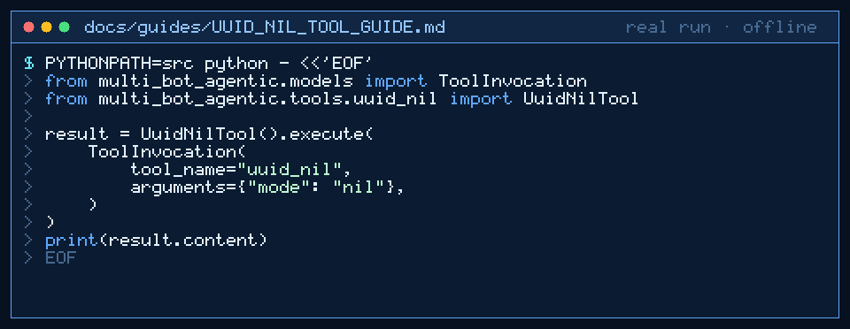

# uuid_nil Tool Guide



Return the RFC 4122 nil UUID (or max UUID) as a stable placeholder id before
the next GPT-6 Astra / Claude Opus 5.5 / Gemini 4 Argon / Kimi K3.1 Pro turn.

## Why

CrewAI / LangGraph-style agent pipelines often need a sentinel identifier
before a real primary key exists. Models mis-count zeros or invent variants.
`uuid_nil` returns a constant stdlib UUID string with no network access.

## Usage

```python
from multi_bot_agentic.models import ToolInvocation
from multi_bot_agentic.tools.uuid_nil import UuidNilTool

result = UuidNilTool().execute(
    ToolInvocation(
        tool_name="uuid_nil",
        arguments={"mode": "nil"},
    )
)
print(result.content)
```

`mode=max` returns `ffffffff-ffff-ffff-ffff-ffffffffffff`.

## Bounds & Safety

- Modes: `nil` (default) or `max`
- Content is always a 36-character UUID string
- Never executes code or makes network requests
