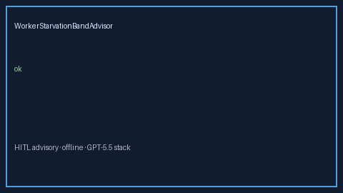

# WorkerStarvationBandAdvisor Guide



Offline HITL advisor for `starvation_ratio` bands.
Gap vs LangGraph/CrewAI/AutoGen worker-starvation band monitors. Distinct from `OrchestratorFairnessAgingAdvisor` / `HandoffTimeoutBandAdvisor`.

Optional polish via **GPT-5.5 / Claude Sonnet 4.6 / Gemini 3.x / Kimi K2**.

## Usage

```python
from multi_bot_agentic.worker_starvation_band import WorkerStarvationBandAdvisor

status = WorkerStarvationBandAdvisor().advise("s1", starvation_ratio=0.3)
assert status.requires_human_review is True
print(status.band)
```

## Safety

Advisory only. No network I/O. Humans decide.
