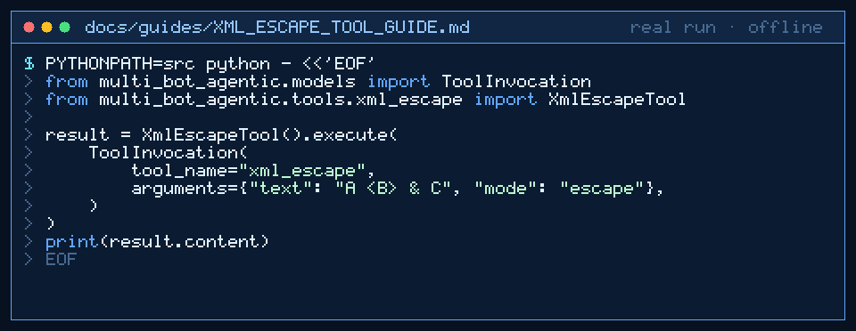

# xml_escape Tool Guide



Escape or unescape XML special characters before the next GPT-6 Astra /
Claude Opus 5.5 / Gemini 4 Argon / Kimi K3.1 Pro turn.

## Why

Agent pipelines that build or scrape XML handoffs need deterministic escaping
of `&`, `<`, and `>`. Models miss ampersands or double-escape. `xml_escape`
uses stdlib `xml.sax.saxutils.escape` / `unescape`.

## Usage

```python
from multi_bot_agentic.models import ToolInvocation
from multi_bot_agentic.tools.xml_escape import XmlEscapeTool

result = XmlEscapeTool().execute(
    ToolInvocation(
        tool_name="xml_escape",
        arguments={"text": "A <B> & C", "mode": "escape"},
    )
)
print(result.content)
```

Unescape with `mode=unescape`.

## Bounds & Safety

- Max text 20_000 chars
- Modes: `escape` (default) or `unescape`
- Never executes code or makes network requests
